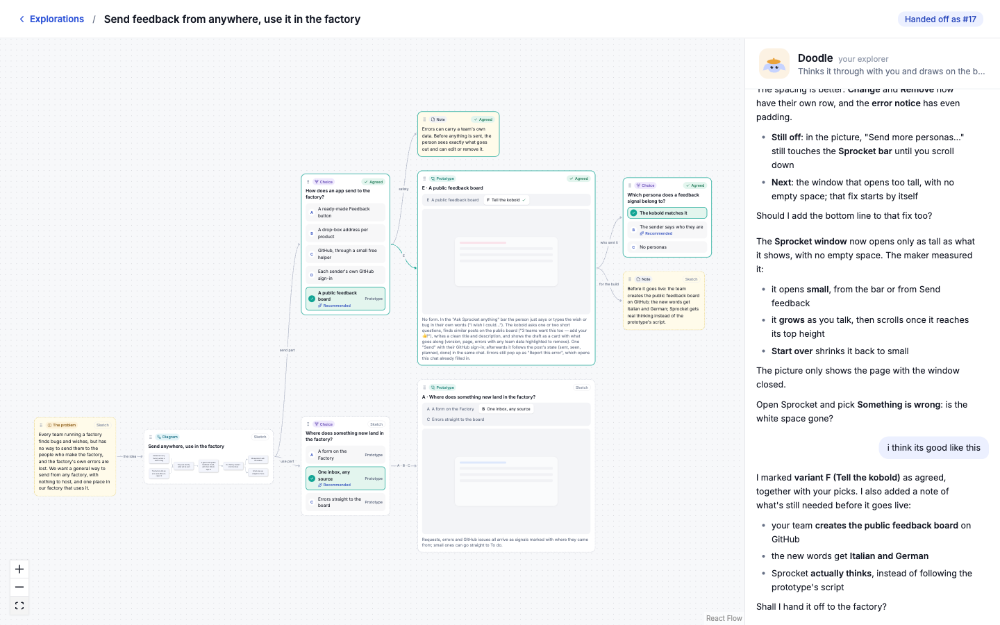
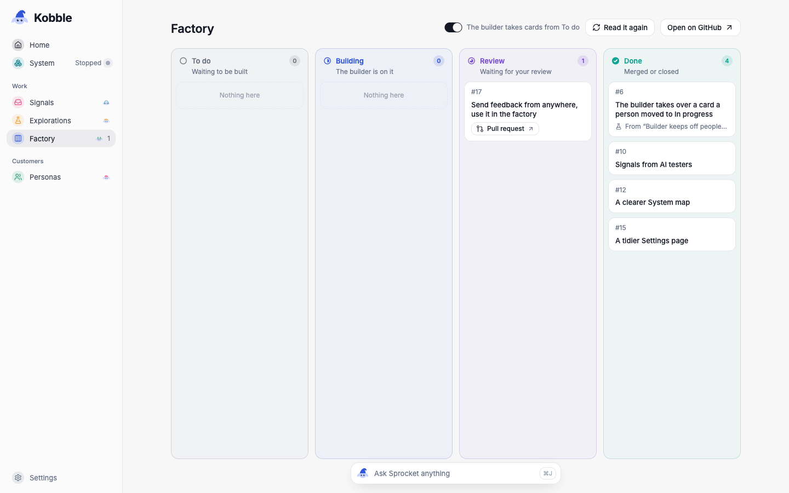
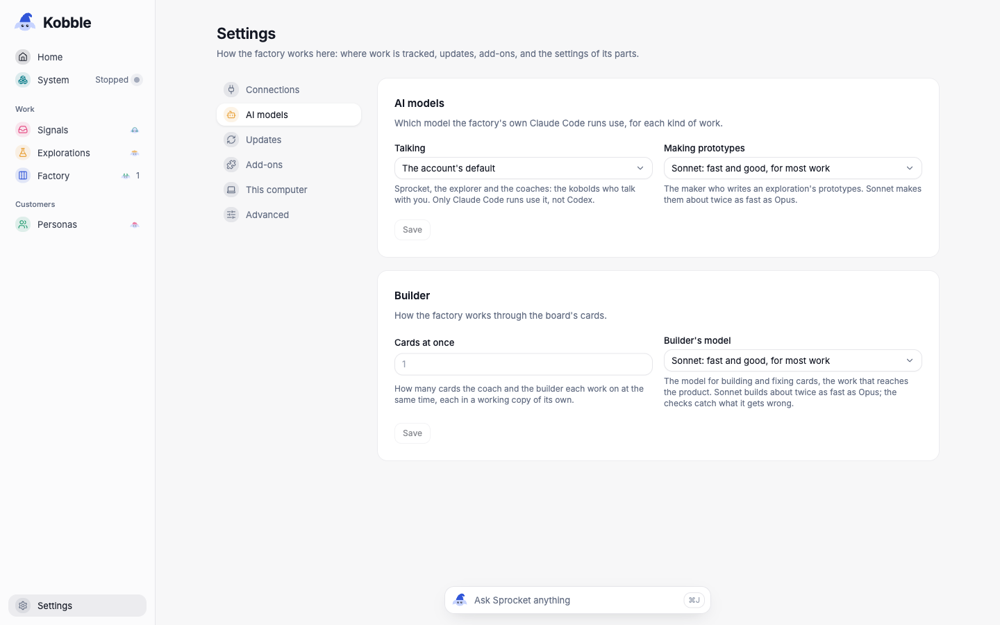
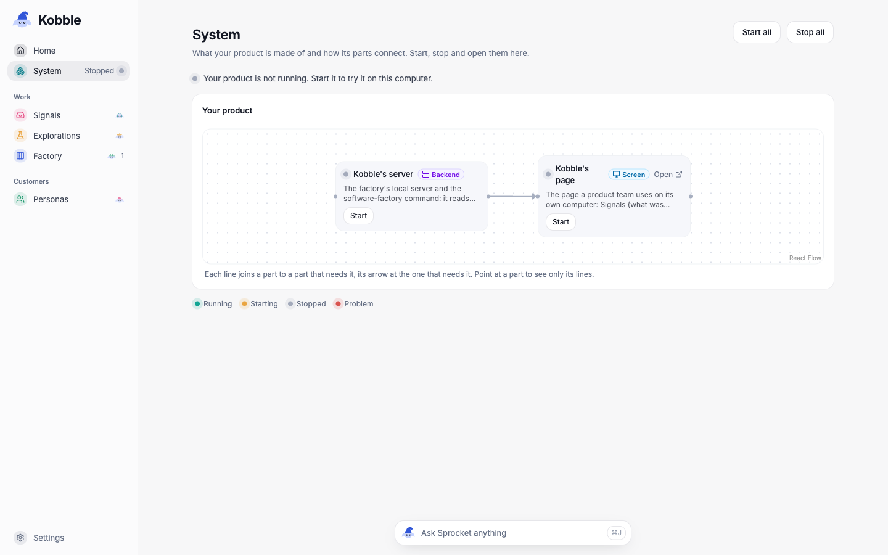

# Kobble

Kobble is an AI software factory for small product teams. It runs on your
own computer, next to your code, and helps you go from "we heard a problem"
to "the fix is merged": you think an idea through with an AI, try it as a
working prototype in your real app, and an AI builder turns the version you
pick into a pull request.

This repository is Kobble's core. Each company keeps its products in its own
repository and installs a released version of this core there.



## What you can do with it

- **Collect signals.** Write down what customers say, connect your live app,
  or send AI personas into your apps on missions. They report the bugs,
  ideas and open questions they run into.
- **Explore an idea before building it.** Talk an idea through with Doodle,
  the explorer. It draws the problem, the choices and their options on a
  whiteboard, and Tinker, its maker, builds them as a **prototype in your
  real app**, with variants you can switch between and click through.
- **Hand the chosen version to the builder.** The agreed variant becomes a
  card with a short spec in To do on your GitHub board: that is the
  go-ahead. The builder builds it test-first in its own working copy, runs
  your checks, pushes only work that passes them and opens a pull request
  for you to review. When it gets stuck, it says why and waits for your
  hint.
- **See and run your product.** System shows the parts your product is made
  of, how they connect, and lets you start, stop and open them.
- **Release your product.** The Releases page turns what was merged into a
  numbered release, with notes written from the pull requests.
- **Ask for help anywhere.** Sprocket, the support kobold at the bottom of
  every page, answers questions, adds explorations and personas for you,
  explains a stuck card and passes your answer on to the builder.
- **Stay up to date.** Kobble takes merged work from GitHub by itself and
  offers each new Kobble release as a card for the builder.



Kobble speaks English, Italian and German. You choose which AI model does
which job: one for talking with you, a faster one for making prototypes, and
one for building.



## Get started

You need Node 24, git, the [GitHub CLI](https://cli.github.com/) and
[Claude Code](https://claude.com/claude-code), signed in.

In your project, add the core as a development dependency, pinned to a
release:

```json
"devDependencies": {
  "software-factory": "github:danielplan/software-factory-core#release-0.14.0"
}
```

Then start it from anywhere inside the project:

```sh
npm install
npx software-factory
```

Kobble opens at <http://localhost:4300>. The first time, a setup coach reads
your code, finds your products and sets up the factory with you. Everything
it keeps lives in your project, in `factory/`.

To use it from another device on your network too, such as an iPad, start it
with `--lan`: it prints an address with a key for that device. Open it there
once; the device keeps the key, and devices without it are turned away.

Other commands:

- `npx software-factory upgrade` brings the factory to the release you pinned.
- `npx software-factory new <name>` starts a new project for a new idea. A
  Every project gets the factory's checks at its top: scripts in
  `package.json` (`npm run verify`) and git hooks (`lefthook.yml`), written
  again by each upgrade; the team's own hooks go in `factory/hooks.yml`.
- `npx software-factory verify` runs every product's `verify` command.



## How it fits together

```text
  YOUR PRODUCTS     your apps and services, their code and knowledge
       ▲            each product describes itself in a product.json
       │
  EXTENSIONS        Signals, Explorations and prototypes, the Factory board and
  AND KITS          its builder, Personas, Releases; where work is tracked
                    (GitHub or Jira); your team's own extensions; kits for each
                    kind of product (React, SvelteKit, Expo, NestJS,
                    TypeScript packages, any other code)
       │
  CORE              products, settings, parts, the AI agents (Claude Code),
                    working copies, skills, the knowledge base and its checks,
                    Home, System, Sprocket, voice, updates
```

The core is the same for every company. Extensions and kits ship with it,
and each company picks the ones it uses in the Marketplace. Your products
stay in your repository.

More detail is in Kobble's [knowledge base](docs/index.md):

- [What Kobble is](docs/explanation/what-kobble-is.md): how work flows from
  signals to releases.
- [How Kobble is built](docs/explanation/how-kobble-is-built.md): the core,
  extensions, add-ons and kits.
- [Features](docs/reference/features/index.md): one page per area of Kobble.
- [Design system](docs/reference/design-system.md): how the page looks.

## Versions

Kobble is at `0.x`. A release you can take without doing anything is a patch
(`0.13.0` → `0.13.1`), even when it brings new features. A release that needs
something from you, such as a migration or a new setting, is a minor
(`0.14.0`), and `npx software-factory upgrade` says what to do. What each
version brought is in the commits between its `v<version>` tag and the one
before; [versions](docs/reference/versions.md) has the rule, and
[make a release](docs/how-to/make-a-release.md) says how a version is made.

## Working on Kobble

Kobble is built with Kobble: this repository has its own factory in
`factory/`, where the dashboard and the server are the products. Because this
repository is public, its explorations (`factory/kobble/explorations/`) stay on
the computer they were made on and are not in git; in a company's own private
repository they are shared through git like the rest of the factory. To run it
here:

```sh
npm install
node packages/server/bin/software-factory.ts . --port 4330
```

To try your working copy in another project, run
`node <this folder>/packages/server/bin/software-factory.ts` there instead of
a release.

Before you push, `npm run verify` runs every check (build, format, lint,
types, dead code, duplicates, tests with coverage, the docs). The git hooks
run it for you. [AGENTS.md](AGENTS.md) has the conventions, and
[your first change to Kobble](docs/tutorials/first-change-to-kobble.md)
walks through one.

| Folder                     | What is in it                                                                                                           |
| -------------------------- | ----------------------------------------------------------------------------------------------------------------------- |
| `packages/core/`           | Products, the company file, extensions, parts, settings, the AI agents, working copies                                  |
| `packages/server/`         | The local server and the `software-factory` command: explorations, prototypes, the builder, missions, updates, trackers |
| `packages/dashboard/`      | Kobble's page, in English, Italian and German                                                                           |
| `packages/kits/`           | One kit per kind of product, with its starter and rules                                                                 |
| `packages/launcher/`       | Starts, watches and stops your product's parts                                                                          |
| `packages/skills/`         | The skills and guides the AI agents follow                                                                              |
| `packages/knowledge-base/` | The template for a project's knowledge pages, and their checks                                                          |
| `factory/`                 | Kobble's own factory                                                                                                    |
| `examples/acme/`           | An example company, used by the tests                                                                                   |
| `scripts/`                 | Building and publishing releases, starting Kobble's prototypes                                                          |
