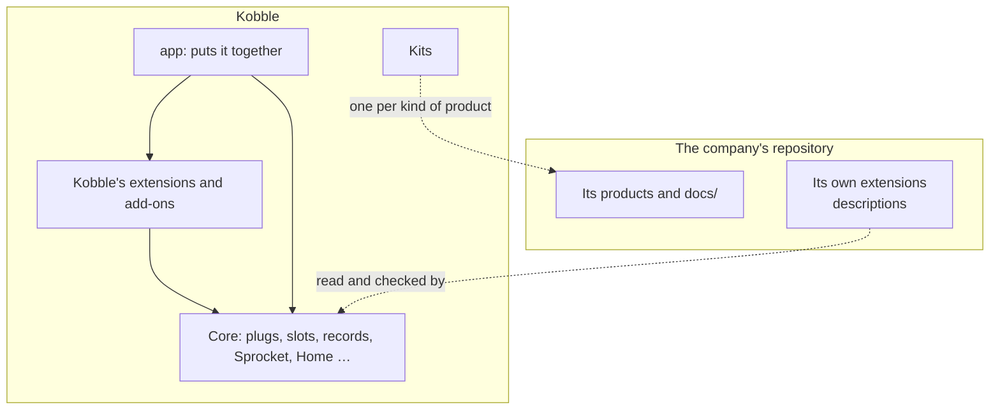

# How Kobble is built

[Knowledge base](../index.md) · [Explanation](index.md)

**Type:** Explanation · Answers: what are Kobble's pieces, and how do they fit together?

Kobble is a small **core** and **extensions** that plug into it. An extension
can be installed and removed, so extensions never talk to each other: they
meet only at **plugs** the core defines. Removing an extension takes away
everything it plugged in, and nothing else breaks
([decision 0011](../decisions/0011-extensions-plug-in.md)).

## The pieces

| Piece                   | What it is                                                                                                                                                                                     | Where                                                                                                      |
| ----------------------- | ---------------------------------------------------------------------------------------------------------------------------------------------------------------------------------------------- | ---------------------------------------------------------------------------------------------------------- |
| Core                    | What every factory has: finding products, the records store, the session and setup, Sprocket, Home, System, Settings, the Marketplace, updates, the feedback board, voice, the plugs and slots | `packages/core/`, and `packages/server/src/` and `packages/dashboard/src/` outside their extension folders |
| Kobble's own extensions | Factory (always installed), Explorations, Signals, Personas, Releases                                                                                                                          | `packages/server/src/extensions/<id>/`, `packages/dashboard/src/features/<id>/`                            |
| Add-ons                 | Extensions that connect a service: GitHub (fills the `code` and `tasks` slots), Jira (`tasks`)                                                                                                 | `packages/server/src/extensions/github/`, `packages/server/src/extensions/jira/`                           |
| A team's own extensions | Descriptions, no code: pages and Home blocks of text and lists, stages, guides, settings                                                                                                       | `factory/extensions/<id>/extension.json` in the company's repository                                       |
| Kits                    | How one kind of product is built: its rules, libraries, checks, starter and prototype mode                                                                                                     | `packages/kits/`                                                                                           |

The other packages serve all of them: `packages/launcher/` starts and stops a
product's parts, `packages/skills/` holds the skills and guides the kobolds
follow, and `packages/knowledge-base/` holds the knowledge base's template
and checks.

## How they fit

Code flows one way: the core knows no extension; an extension knows the core
and the plugs, never another extension; the **app** puts them together. Both
halves of Kobble, the server and the page, are laid out this way: see
[one layout for both halves](one-layout-for-both-halves.md).

## What an extension can bring

An extension says what it **brings** (pages, Home blocks, kobolds, stages),
what it **needs** (other extensions, by id), which **slots** it uses (`code`,
`tasks`) and, for Factory only, that it is **always** needed. Installing one
brings what it needs; removing one that another needs is refused; a factory
with a need missing does not start, and says why (`assembleFactory` in
`packages/core/src/extensions/registry.ts`).

How one extension plugs in, what the host gives it, and who owns which
records: [extensions and plugs](extensions-and-plugs.md).

## Kits

A kit teaches the factory one kind of product: how to recognise it in
existing code, the commands it usually has, the parts that run it, its rules
and one library per job, the tools its agents use, and how to make a new one
(from a starter with the kit's standards and prototype mode, or the
framework's own generator). The kits are React web app, Expo app, SvelteKit
web app, NestJS backend, TypeScript package, and other code for anything
else. The React web app, Expo app and NestJS backend kits have starters of their
own; the SvelteKit and TypeScript package kits use the framework's
generator. A product can give a working copy its own environment (its own
ports and database, `copyEnv` in its `product.json`): the NestJS backend's
starter takes a copy's own database as `DATABASE_NAME`, and gives each
copy's tests a database of their own. Kobble itself is built with its own kits. See
[add a kit](../how-to/add-a-kit.md).

## A team's own extensions

A team asks Sprocket for something Kobble does not do. It is explored, then
the builder writes the extension as a description in the company's factory
folder, and the team reviews it like any change. Because it is a description
and never code, it cannot break the rules on this page
([decision 0014](../decisions/0014-team-extensions-are-descriptions.md)).
See [the Marketplace and extensions](../reference/features/marketplace-and-extensions.md).
