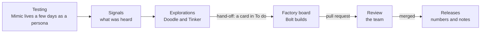

# What Kobble is, and how work flows

[Knowledge base](../index.md) · [Explanation](index.md)

**Type:** Explanation · Answers: what is Kobble for, and how does a piece of work go from something heard to something released?

Kobble is a software factory for small product teams. It is a page in the
browser, served by a small program on the team's own computer, next to the
code. Its agents are **kobolds**: each is Claude Code running on this
computer with a guide and tools of its own. The people who use it are not
developers, but they are curious and capable.

## The loop

Work goes one way, from what the team hears to what it releases. Each step is
an area of Kobble, brought by an [extension](how-kobble-is-built.md).

1. **Signals.** What the live app reports, what people post on the feedback
   board, and what personas find while living a few days in the app. Each signal is
   a bug, an idea or a question. See [Signals](../reference/features/signals.md).
2. **Explorations.** The team thinks an idea through with **Doodle**, the
   explorer, on a whiteboard. **Tinker**, Doodle's maker, builds it as a
   prototype in the real app, with variants to click through. When the team
   agrees on one, Doodle hands it off. See
   [Explorations](../reference/features/explorations.md).
3. **The Factory board.** The hand-off is a short card in **To do** on the
   team's board: that is the go-ahead. There is no planning stage
   ([decision 0002](../decisions/0002-no-planning-stage.md)). **Bolt**, the
   builder, builds the card test-first in a copy of its own, runs the checks
   and opens a pull request. See [the Factory](../reference/features/factory.md).
4. **Review.** The team reviews the pull request and merges it. The builder
   answers comments on the same branch; it never merges.
5. **Releases.** The Releases page turns what was merged into a numbered
   release, with notes written from the pull requests. See
   [Releases](../reference/features/releases.md).

**Testing** feeds the loop before there are real customers: **Mimic**, the
tester, lives a few days in the app as one of the personas, following a
story with their own material, and reports what it finds as signals. See
[Testing](../reference/features/testing.md) and
[Personas](../reference/features/personas.md).

## Sprocket, the guide

**Sprocket** is at the bottom of every page. People ask it how Kobble works,
or tell it what they want done. It finds out what they want, takes them to
the right page, and hands the work on to the kobold whose job it is: an idea
to Doodle, a test to Mimic, an answer on a stuck card to Bolt. It does
nothing alone ([decision 0010](../decisions/0010-sprocket-is-the-guide.md)).
See [Sprocket](../reference/features/sprocket.md).

## What people decide

Kobble does the work, and people decide. A person agrees a prototype before
it is handed off, moves a card to To do or presses **Continue** to let the
builder go on, reviews and merges every pull request, and presses the button
that makes a release. Nothing reaches the main branch except through a pull
request ([decision 0006](../decisions/0006-work-reaches-main-through-a-pull-request.md)).

## Where the work lives

Everything Kobble keeps lives in the team's own repository, in its
`factory/` folder, and travels with the code through git. There is no server
to host: see [a factory in the project](a-factory-in-the-project.md).
