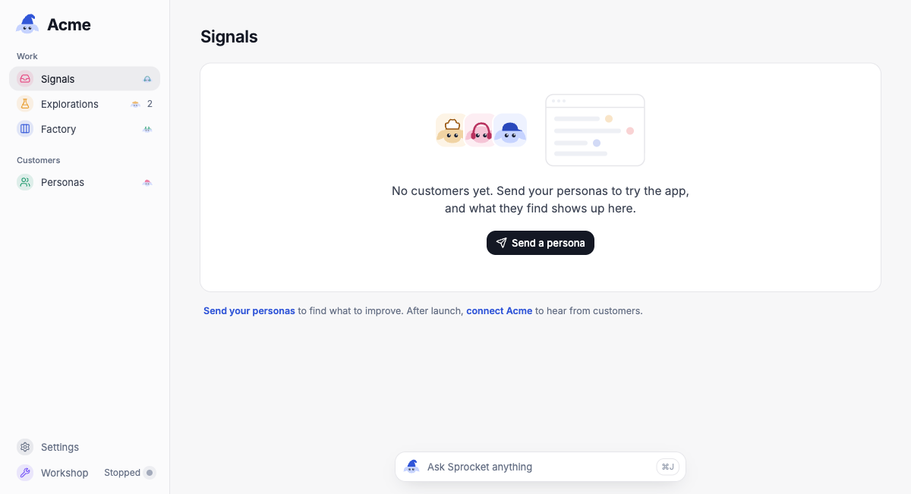
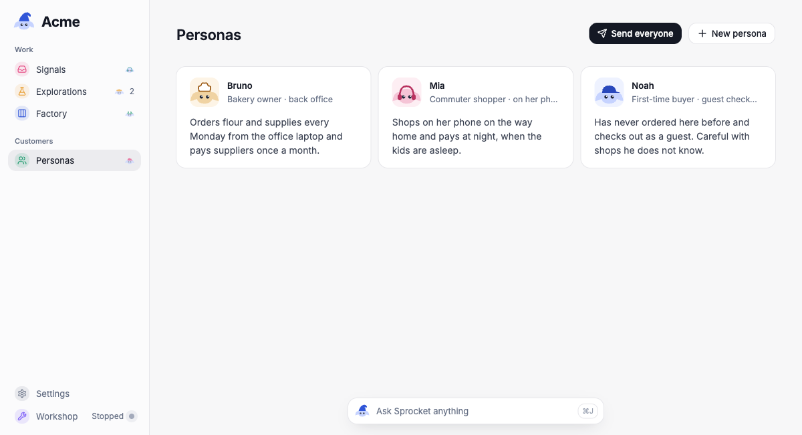
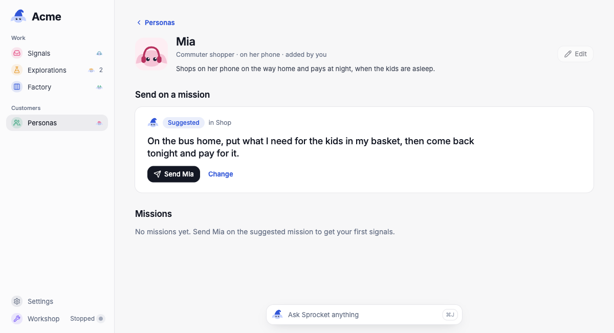
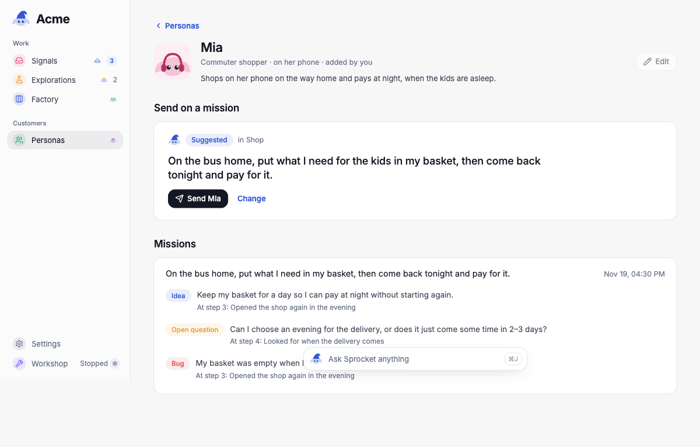
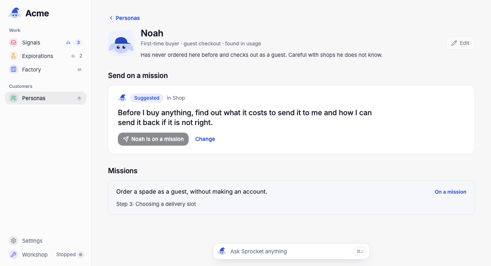
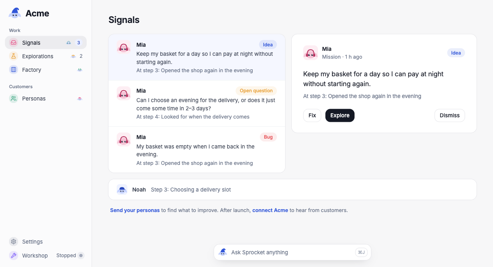
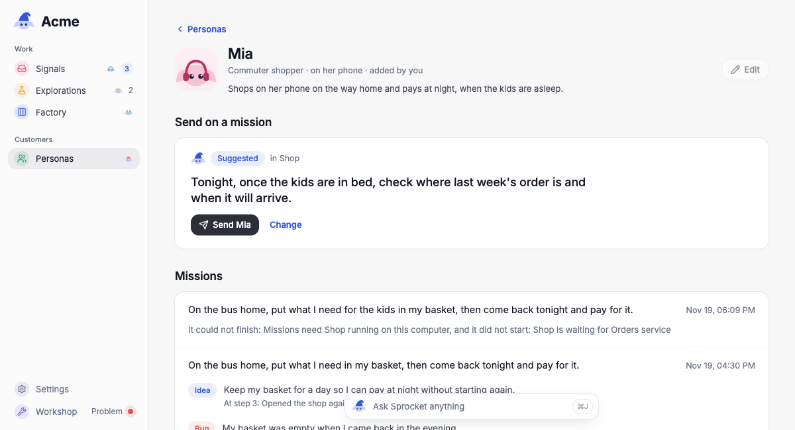

# Signals from AI testers

## Request

Card [#10 Signals from AI testers](https://github.com/danielplan/software-factory-core/issues/10).

Before launch there are no customers, so the Signals page is empty: the live
export has nothing to send and no persona test has run. Before launch, a
signal is something learned while building that might change what we build.
The team sends AI testers (the personas) into the apps: each persona tries
its own app, with a mission the kobold suggests, and what they run into comes
back as signals (bug, idea, open question), each linked to the step where it
happened. Several can run at once. Connecting the live app becomes a small
line for later.

Agreed: **A2 · One suggested mission** (prototype on `proto/X-1-a2`,
exploration X-1).

Where things stand (main, core 0.11.x): persona tests exist (Personas →
a persona → Tests tab), one at a time in a queue, run on the first product
with a web address; the analyst files `bug` or `feedback`; the empty Signals
page only offers to connect the live app.

## Plan and checks

What people see (as in prototype A2):

1. **Signals, empty, before the live app is connected:** a calm picture (the
   personas' face tiles beside a plain app screen), one sentence ("No
   customers yet. Send your personas to try the app, and what they find shows
   up here."), one button to Personas, and a small line "After launch,
   connect <app> to hear from customers" that opens today's connect card.
   Signals from missions show in the usual Signals list, with the step where
   each happened.
2. **Personas:** cards in a grid with face, name and description, read only;
   a card opens the persona's page. **Send everyone** at the top sends each
   persona not on a mission yet with the kobold's suggestion.
3. **A persona's page:** who they are (and which app they use), then **Send
   on a mission**: the mission the kobold suggests, marked _Suggested_ with
   the kobold's face, **Send <name>** and **Change** (once the words are
   changed, the badge goes). Then one list **Missions**, newest first: the
   one running on top with its quiet progress ("Step 3: choosing a delivery
   slot"), then each past one with its date, its words and the signals it
   found (bug, idea, open question), each at its step, linking to Signals.
   No tabs. Signals from real customers (not from missions) show under
   "From real customers" only when there are any.
4. A mission's own page (what the kobold did, step by step) stays, reached
   from the list.

Underneath:

- **Signal kinds** `idea` and `question` (open question) join bug, request
  and feedback; missions file bug, idea or question.
- **The step** a signal happened at is kept on the signal (`step`: the
  mission, the step's number and what the persona did there).
- **Several missions at once:** each starts right away, at most 3 at a time
  (the rest wait); one at a time per persona (a second is refused while one
  runs).
- **The kobold suggests a mission** for a persona from who they are and the
  apps there are: one sentence and which app (product). Kept in memory on
  the server until a mission is sent, then a new one is asked for.
- **Each persona tries its own app:** a mission records the product it ran
  on; the factory starts that product. A product started by two missions at
  once is started once.
- **"Tests" are called missions** in everything people see. The records
  keep their names (`kobble/tests/T-0001.json`), so no file moves and no
  migration.

Checks: server tests for several at once, one per persona, the step and the
kinds, the suggestion; dashboard view tests for the words; the full
`npm run verify`; screenshots of the three pages with the example company.

Decisions taken while building (cheap to change later):

- At most 3 missions at a time: each is a browser and a Claude Code session
  on the owner's computer; more would slow it down for little gain.
- Progress shows "Step N: <what it is doing>" without a total: the persona
  agent does not know in advance how many steps it will take. It writes a
  line per step as it goes, which the factory reads while it runs.
- The suggestion is not saved in the persona's file: it is a draft, and a
  persona's file is shared with the team through git.
- Records keep the name `tests` (see above).

Later (not in this card): missions again after each merge.

## Status

done. Built as planned, in that order: the core (signal kinds `idea` and
`question`, the `step` on a signal, `product` and `doing` on a test), the
runner (several at once, one per persona, the step line), the kobold's
suggestion, then the pages. The card's branch started 55 commits behind main
(at core 0.11.0); it was moved forward to main first (it had no commits of
its own), so the pull request has only this card's changes.

## Result

What was built is in the plan above. Tried on a copy of the example company
(`examples/acme`), with the real Claude Code for the suggestions:

How to try it: open a persona on Personas, wait for the kobold's
suggestion, press Send (the factory starts the app named under Suggested).
Follow it on the persona's page or on Signals.

Checked: `npm run verify` passes in full (format, lint, types, unused code,
copy-paste, 311 tests with coverage at 97% of lines, the records and the docs
check). New tests for several at once, at most 3, one per persona, the app
started once, the step line, the kinds and steps of findings, the suggestion
(kept, refused when unreadable, asked again on purpose) and the page's words.

`check:docs` failed on main the same 10 ways before this card (since
8 November): skills and templates name a company's `docs/index.md`,
`docs/decisions/` and so on, which the check looked for at the core's root,
because the core has a `docs/` of its own. Fixed in the check rather than in
the skills' words: a path into `docs/` may also point into any knowledge base
there is (a `docs/` or `context/` folder with an index.md, as the template).
A path in none of them is still reported, with a test for both.

Checked again in a second session (2026-11-19), before the pull request:
`npm run verify` passes in full, 311 of 311 tests, 97% of lines covered.
Checked a third time (2026-11-19, the branch up to date with main): the
same, 311 of 311, 97% of lines; the pull request's description written.
Checked a fourth time (2026-11-19, a new session, nothing new on main): the
same, 311 of 311, 97% of lines.
Checked a fifth time (2026-11-19, a new session, nothing new on main): the
same, 311 of 311, 97% of lines.
Checked a sixth time (2026-11-19, a new session, nothing new on main): the
same, 311 of 311, 97% of lines. The scope is finished; nothing more to build.

Not checked: a whole real mission (browser and persona agent) to the end:
the example company's apps do not start on this computer without their
packages and backend, so the real run stopped at "Shop is waiting for Orders
service", which the page showed plainly. The finished and running missions
in the screenshots are made-up records written into the copy.

## Later

- Missions again after each merge (agreed for later on the card).
- A persona could say which app it uses (today the kobold picks it each
  time from who they are).
