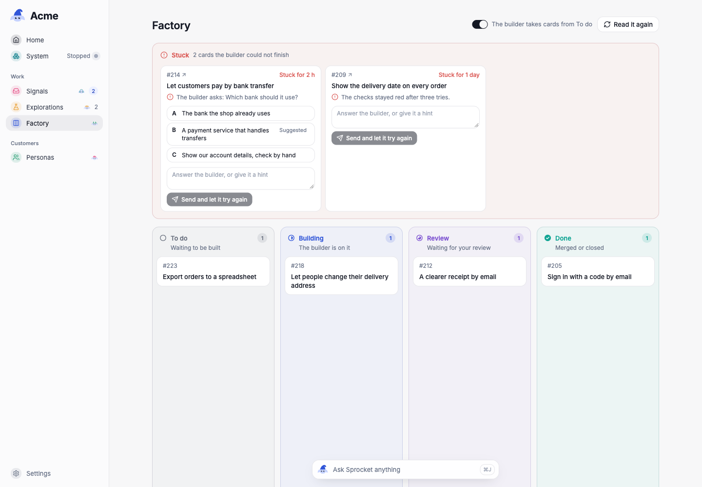
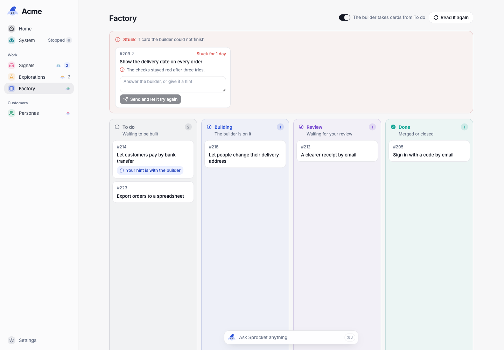

# The builder keeps to its own cards

## Request

Card [#6 The builder takes over a card a person moved to In progress](https://github.com/danielplan/software-factory-core/issues/6).

When a person moves a card to In progress to work on it by hand, the builder
sees it there and resumes it as its own interrupted build; it even detached
the person's worktree to take the card's branch. Two people's work collide on
one card.

Agreed: **A · A list above the board** (exploration X-4, prototype on
`proto/X-4-a`): cards the builder got stuck on show in a "Stuck" list above
the columns, next to "Waiting for you", each with its reason, the builder's
suggested answers as quick picks when it asked a question, a box "Answer the
builder, or give it a hint" and "Send and let it try again". Only variant A
is built, without the variant switch or the made-up cards.

## Plan and checks

What we learned in the exploration, as rules:

1. **A card is the builder's only when the builder itself was the last to
   move it to In progress.** In the card's thread, the factory's last note
   (leaving out "progress" and "paused", which only report) is `started`.
   A card in In progress without that is a person's: left alone.
2. **Stuck cards go to Backlog**, not to To do or In progress: when the
   builder asks a question (blocked), cannot finish (failed), or the checks
   stay red after three rounds (checks-failed), it writes its note, moves the
   card to Backlog and gives it the label `factory: stuck`.
3. **Backlog is read as new ideas**; a card with the stuck label is the
   builder's own and shows only in the Stuck list, never among the ideas.
4. **To hand a card back, move it to To do.** The builder takes it from
   there (a new `started`), and takes the stuck label off.
5. **A reply from the Stuck list** goes into the card's conversation (a
   comment), and the card moves to To do; on the Factory page it shows at the
   top of To do with "Your hint is with the builder".
6. **The card's branch is taken only from the factory's own copies** (its
   build copies and the prototype copies in `<project>-prototypes/`). When it
   is checked out anywhere else, the builder does not take it: it says so on
   the card with the note `by-hand` and leaves the card in In progress, as a
   person's.

Cards from before (the board as an older builder left it):

- In To do, waiting for an answer to the builder's question, without the
  stuck label: moved to Backlog with the label (they show in Stuck).
- In In progress after failed checks, without the label: with a comment from
  the owner since, moved to To do (they asked for another try); without,
  moved to Backlog with the label.

Decisions taken here (cheap to change later):

- The stuck mark is a label, not only the thread: the board's list already
  carries labels, so the factory need not read every Backlog card's
  conversation each minute to tell stuck cards from ideas. On GitHub people
  see the label too.
- "Waiting for you" keeps the questions on cards that are not stuck (older
  `question` notes); a stuck card shows in Stuck only, on the Factory page
  and on Home ("Answer").
- A stuck card's "since" is the time of the builder's note.

Checks:

- `test/board-rules.test.ts`: a card moved to In progress without a
  `started` note is not resumed; one with the builder's `started` note still
  is; one where a later note ended it (a question, review-ready) is not.
- The board rules for stuck cards, the hand-back and the cards from before.
- The builder: a question, a failure and red checks move the card to Backlog
  with the label; starting a card takes the label off.
- Core: a branch checked out in a worktree outside the factory's folders is
  not detached (`BranchTaken`), and the builder skips the card with a note.
- The Factory page: the Stuck list, sending a hint (comment + To do), the
  chip on the card in To do.

## Status

done

- [x] Board rules (decide): whose card, stuck, hand-back, cards from before
- [x] The builder: stuck → Backlog + label, label off on start, branch taken
- [x] Core: free only the factory's own copies
- [x] Server: stuck cards in the work view, hint on the answer, ideas without them
- [x] Factory page: Stuck list, hint chip; Home
- [x] Docs (architecture), CHANGELOG, show-result

## Result

The Factory page with two stuck cards: one where the builder asks (its
suggested answers as quick picks), one with red checks:

After picking B and sending: the card leaves Stuck, and at the board's next
reading it is first in To do with "Your hint is with the builder":

Checked: `npm run verify` passes in full (337 tests, 96.8% of lines
covered). New tests: the board rules (a card in In progress without the
builder's start is not resumed, with it it is, a later note ends it; stuck
cards, hand-back, cards from before), the builder (red checks, a question and
a failure each go to Backlog with the label; To do again starts it and takes
the label off; a card moved to In progress by hand and one whose branch is
open in a person's worktree are left alone, with one `by-hand` note), the
core (a branch open outside the factory's folders, or in the owner's own
checkout, is never detached), the Stuck list's words and Home.

Not checked: against a real GitHub board. The screenshots are the real page
on a copy of the example company with the board's answer made up in the
browser (the copy has no board); the label commands are checked as the
commands they make, not run against GitHub.

## Later

- A card a person works on in In progress could say so on the Factory page
  ("In progress by hand"); the plan did not ask for it.
