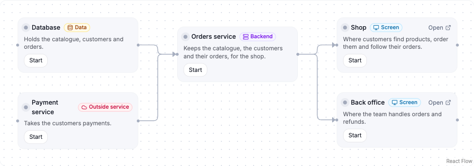
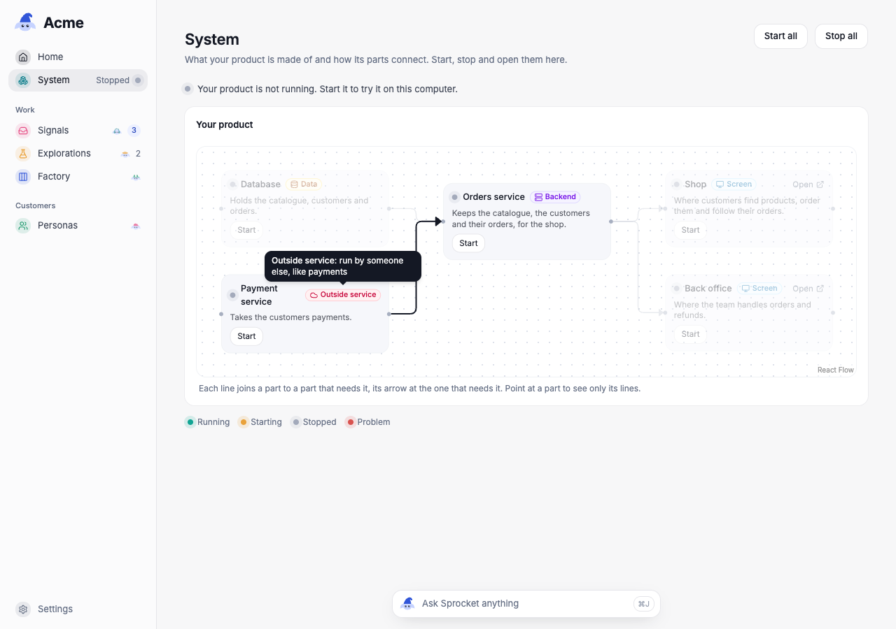
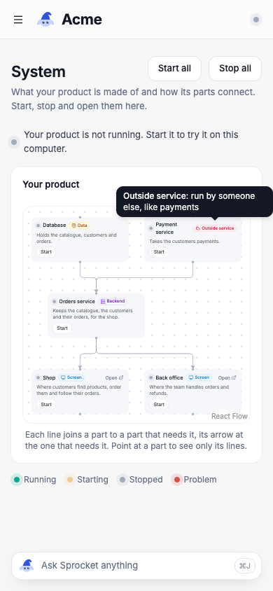

# A clearer System map

## Request

Card [#12 A clearer System map](https://github.com/danielplan/software-factory-core/issues/12).

The System page shows the product's parts in columns with one arrow between
columns, so the team cannot see which part actually needs which. It should
show clearly how each part connects to the others, well structured.

Agreed: **A3 · Real map with lines** (prototype on `proto/X-2-a3`,
exploration X-2).

Where things stand (core 0.12.0): System shows "Your product" as columns
(`columnsOf`), one arrow between columns; parts (`Part` in
`packages/core/src/parts/part.ts`, made by the kits from each product) do not
say what type of part they are.

## Plan and checks

What people see (as in prototype A3):

1. **A real map.** "Your product" on System is a map: each part a box (its
   light, name, Open, buttons, problem, as now), laid out left to right with
   the same layout as an exploration's board (ELK), and a line from each part
   to exactly the parts that need it, its arrow at the part that needs it.
   Pointing at a part brings out its own lines and the parts at their other
   ends; the others fade. A line under the map says how to read it.
2. **A type tag in each box,** inside it, in the header row right after the
   part's name, on the same line: Screen, Backend, Data or Outside service,
   each with its own colour and small icon. No key under the map: pointing
   at a tag, focusing it with the keyboard or tapping it shows only that
   tag's meaning: Screen "what people open, a web page or app"; Backend
   "works behind the screens"; Data "where data is stored"; Outside service
   "run by someone else, like payments".
3. **Parts say their type.** A part gets an optional `type` (`screen`,
   `backend`, `data`, `outside`). The kits set it: React web app, SvelteKit
   app and Expo app are screens; NestJS backend and TypeScript package work
   behind the screens. A product may say its own in its `product.json`
   (`type`), which wins over its kit's: the way for "Other code" (which
   cannot tell), a database or an outside service. A part with no type shows
   no tag.
4. The factory's own programs (in Settings) keep their columns.

Checks:

- Core: a part's `type` is one of the four and optional; a product's `type`
  is read from `product.json`.
- Kits: each kit's part has its type; the product's own type wins.
- Launcher: a part's view carries its type.
- Dashboard: the lines of the map (who needs whom, only known parts) and the
  four types' words, as tests; the map's look, the tooltip and the
  highlighting in the browser (show-result, screenshots).
- `npm run verify` passes.

Decisions made while building (cheap to change):

- The tag first followed the prototype (its own line above the name); the
  card's agreed text, updated by the owner, asks for it in the header row next
  to the name, on the same line, so it now sits there.
- A long name next to a wide tag ("Payment service" beside "Outside
  service") wraps onto a second line rather than being cut short, so the tag
  never hides part of the name.
- No guessing of a part's type from its name (the prototype guessed, since
  parts did not say): a guess shown as a fact can be wrong; a part without a
  type shows no tag, and its product can say it.
- The field is called `type`, since a product's `kind` already means its kit.
- On a narrow screen (under 600 pixels wide, a phone) the map runs top to
  bottom, lines coming in above each box and leaving below: left to right,
  the map shrank so far on a phone that the boxes could not be read. The
  prototype did not show a phone.

## Status

done

## Result

System's "Your product" is a map: each part a box with a line to each part
that needs it, laid out left to right (top to bottom on a phone). Each box
has a small coloured type tag right after the part's name, on the same line; pointing at it, focusing
it with the keyboard or tapping it shows only that type's meaning. There is no
key under the map. Parts say their type: the kits set it, and a product's
`product.json` may say its own (`"type": "data"`), which wins.

How to try it: start the factory on a project
(`npx software-factory`), open System. To see Data and Outside service tags,
add `"type": "data"` or `"type": "outside"` to a product's `product.json`.

Checked: `npm run verify` passes in full (format, lint, types, unused code,
copy-paste, tests with coverage, records, docs). In the browser, with a copy of
the example company given three made-up products more (a back office, a
database and a payment service, only in a throwaway folder): the map and its
lines, pointing at a part and at a tag, a tag focused with the keyboard (only
its meaning shows), a phone-sized screen. Later, with the tag moved next to the name: the map,
pointing at a tag and the phone again; every part's name shows in full (a
long one on two lines).

Not checked: a real phone or tablet (the phone screenshot is a narrow
desktop browser; a tap was tried as a mouse click, before the tag moved); screen readers beyond the tag's
name, which carries its meaning; parts actually running (the example
company's apps do not start here), so the lights are all "stopped".

## Later

- A product of Other code with no start command (a database or an outside
  service the team does not run) makes no part, so it is not on the map even
  when its `product.json` says its type. Showing such products on the map,
  without Start, would make the map complete.
