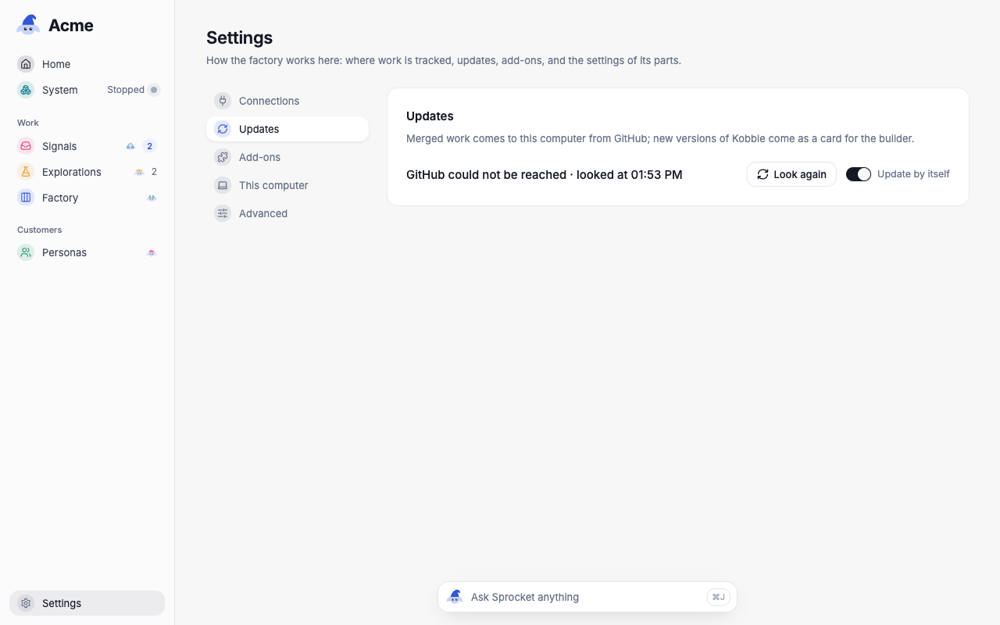
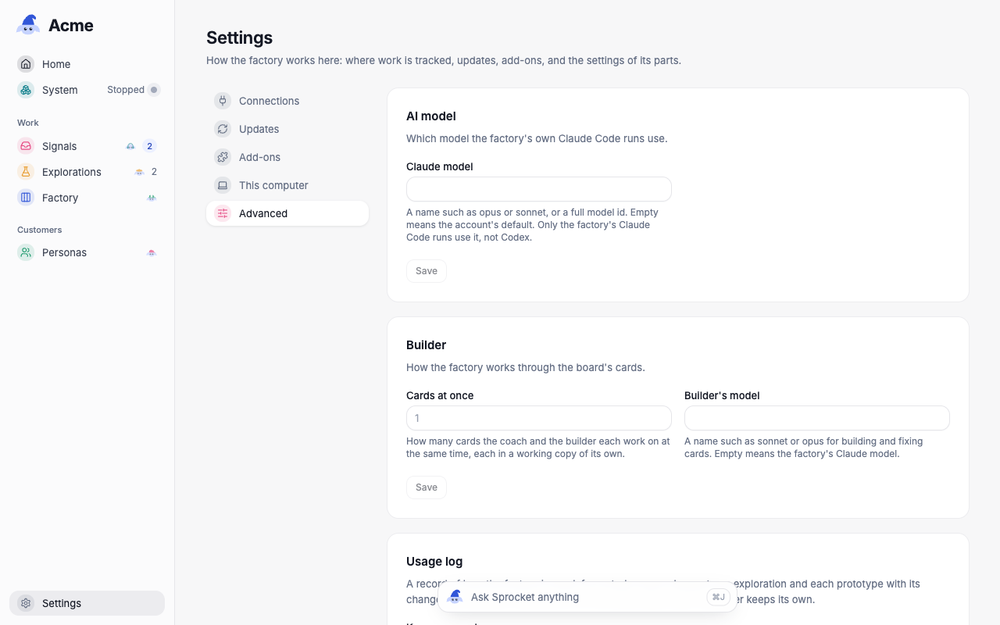
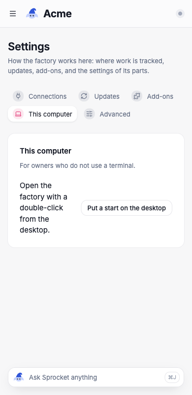

# A tidier Settings page

## Request

Card [#15 A tidier Settings page](https://github.com/danielplan/software-factory-core/issues/15).

Settings is one long scroll of very different things: where work is
tracked, the live app, updates, add-ons, the factory's programs, this
computer, and each part's settings. Owners scroll past everything to find
the one thing they came to change.

Agreed: **A · Tabs, one page each** (prototype on `proto/X-3-a`,
exploration X-3), with the changes the team asked for along the way.

Where things stand (core 0.12.0 and after): `SettingsTab` shows every
section one under the other, with a list of their names at the side that
scrolls to each (hidden on a narrow screen).

## Plan and checks

What people see (as in prototype A, its last version):

1. **Five tabs** at the side of Settings, each with its icon:
   - **Connections**: where work is tracked, the live app.
   - **Updates**.
   - **Add-ons**: the add-ons and kits.
   - **This computer**: the start on the desktop.
   - **Advanced**: the factory's programs and each part's own settings
     (the settings groups no add-on has).
2. **Only the chosen tab shows**, with its own address (`#settings/updates`,
   `#settings/this-computer`, …), so a reload or a link stays there and the
   back button goes back. `#settings` alone opens Connections.
3. **The chosen tab** sits on white, like a card on the grey page, with the
   text and icon of the chosen page in the left sidebar (dark text, the icon
   in its colour); the others are plain grey text with a grey icon.
4. A tab with nothing in it does not show.
5. Old addresses: `#add-ons` and `#workshop/add-ons` now open the Add-ons
   tab; the "Change" link of a board add-on opens Connections.

Left out: variants B and C and the variant switch (`?variant=`).

Checks:

- Dashboard (tests): which tab each section goes in, the tab's address, the
  tab an address opens (an unknown or no address: the first), empty tabs
  left out; the old addresses.
- In the browser (show-result, screenshots): each tab, the chosen tab's
  look, a reload staying on the tab, a narrow screen.
- `npm run verify` passes.

Decisions made while building (cheap to change):

- On a phone the tabs wrap into rows above the chosen tab's cards (two
  rows on a 390px screen). Before, the side list was hidden on a phone; with
  one tab at a time it must stay, or the other tabs could not be reached.
  The prototype did not show a phone.
- "This computer" comes before "Advanced" in the tabs, and the factory's
  programs come first in Advanced, before the settings groups, as in the
  prototype.
- The grouping and the addresses live in their own small file
  (`settings-tabs.ts`) so they can be tested without a browser; the page
  (`settings-tab.tsx`) only draws them.
- A board add-on's "Change" link (on Add-ons) now opens Connections, where
  the board is changed; before it opened Settings at the top, which is the
  same place.

## Status

done

## Result

Settings shows five tabs at the side: Connections, Updates, Add-ons, This
computer and Advanced; only the chosen one's cards show, at its own address
(`#settings/updates`). The chosen tab is white with dark text and its icon
in colour; the others are plain grey. Variants B and C and the variant
switch were left out.

How to try it: start the factory (`npx software-factory`), open Settings,
click through the tabs, reload on one (it stays), use the back button.

Checked: `npm run verify` passes in full (format, lint, types, unused code,
copy-paste, 347 tests with coverage, records, docs); new tests for the tabs
(which section goes where, the addresses, the tab an address opens, empty
tabs left out) and for the old addresses. In the browser, on a copy of the
example company (in a throwaway folder): each tab, the chosen tab's look,
`#add-ons` opening Add-ons, a reload and the back button staying on the
right tab, a phone-sized screen.

Not checked: the factory's programs under Advanced (the example company has
none, so that section does not show; it is the same card as before); a real
phone; a screen reader beyond the tabs being links with the chosen one
marked as the current page. Connections was looked at but not kept as a
screenshot, since it showed the signed-in GitHub account.

## Later
