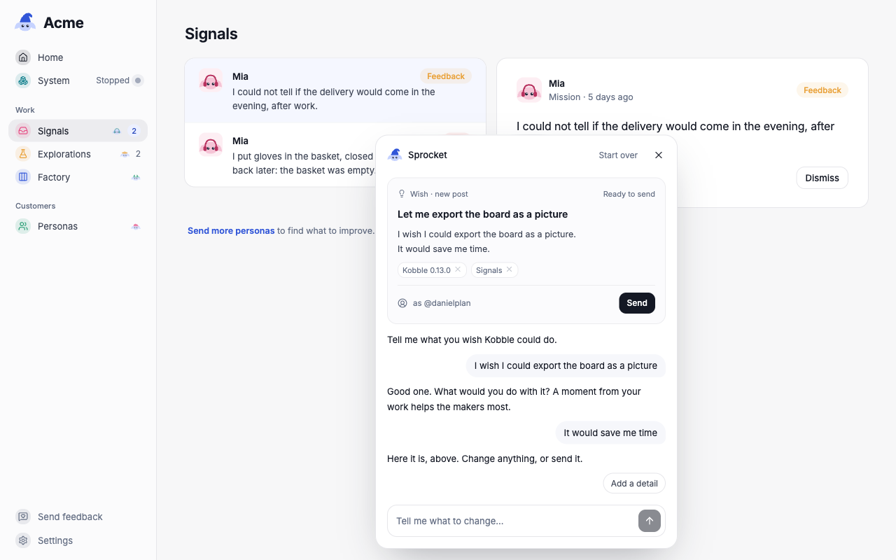
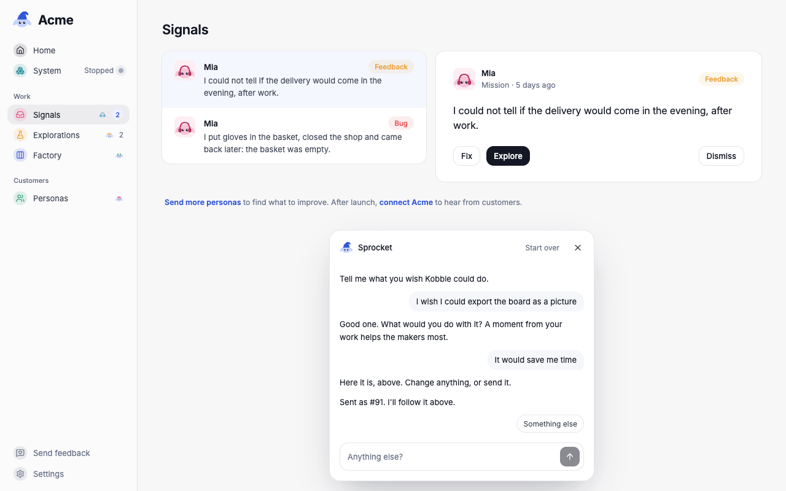

# Send feedback from anywhere

## Request

Card [#17 Send feedback from anywhere, use it in the factory](https://github.com/danielplan/software-factory-core/issues/17).

Every team running a factory finds bugs and wishes but has no way to send
them to the people who make the factory. Agreed: **E · a public feedback
board** (a separate public GitHub repository just for feedback; anyone with a
GitHub account sends from their factory; nothing to host), with the variant
**F · Tell the kobold** as the way in: one Sprocket window, no form. The
prototype is on `proto/X-5-e` (variants E and F, `?variant=`); only F is built
here, with its twelve changes.

## Plan and where it stands

1. **UI, variant F only** (from the prototype, without E and the variant
   switch): Sprocket's one window, opening only on a click, adapting to the
   page, three starting choices, the post building itself live, 👍 on similar
   posts, one Send, the live state after it, spacing and height fixes (changes
   1–12). **Done.** Split into small files for the lint rules.
2. **The board for real**, through the GitHub CLI and the person's own
   sign-in (`packages/server/src/feedback/`): send, 👍, read the board for
   similar posts and states. **Done.** The prototype's made-up board, errors
   and sign-in are gone; errors are the ones the page really catches.
3. **Posts from the board as signals** in the factory that reads it, matched
   to personas, with Change/Remove. **Done.**
4. Words in English, Italian and German. **Done** (the prototype had them).
5. Tests, docs, change log. **Done** (server and dashboard tests,
   `docs/architecture.md`, `CHANGELOG.md`).
6. Click-through in a browser (change 10). See the end of this file.

Decisions the plan did not settle (cheap to change):

- **Which factory reads the board**: `FACTORY_FEEDBACK_READS=yes` in
  `factory/team.env`, read by hand-editing the file; no settings group yet.
  Reason: only the makers need it, so no screen for everyone.
- **State of a post**: no label = sent, label `seen` or `planned`, closed =
  done. Kind is the label `bug` or `wish`. The makers use these labels on the
  board.
- **Posts that are the person's own** (sent here) are shown by the chat and
  Signals from `factory/settings/feedback-sent.json`, not from the board's
  author, so a second computer of the same person does not see them.
- **Signing in** reuses the GitHub add-on's sign-in (`gh auth login --web`,
  the one-time code is shown in the card); sending starts after it.
- The kobold's chat steps stay a short script in the browser (the card says
  real thinking comes before it goes live).

Not done, said plainly: the board repository does not exist yet (the makers
create `<owner>/software-factory-feedback` with the labels `bug`, `wish`,
`seen`, `planned`); a send before then says so in the card. Sprocket's
thinking is still the script, not a model.

## Click-through (change 10)

Run in a browser against the real server (the example company, GitHub
stood in only for the final Send, so nothing reached the real board):

- Nothing opens by itself; "Ask Sprocket anything" and "Send feedback" open
  the window, which is only as tall as what it shows (165 px at first), and
  grows with the conversation. Escape closes it; it opens again with the
  opening.
- "I wish Kobble could…" → typed wish → quick reply → the card fills in
  live (title, text, version, page) → Send → "Sent as #91" → Start over →
  the opening again.

Found and fixed: after Send, the status card at the top disappeared until the
board listed the post again; the server now keeps the post as sent and shows
it meanwhile.

Not clicked: "Something is wrong" and "Ask a question" paths, "Report this
error" and removing team data in the browser (covered by unit tests for the
draft only), the signed-out sign-in with its one-time code, and a real send
to GitHub (the board does not exist yet).
