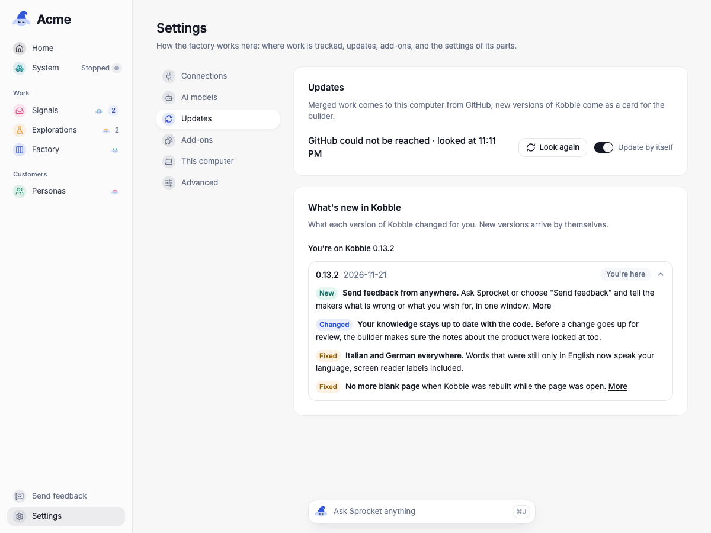
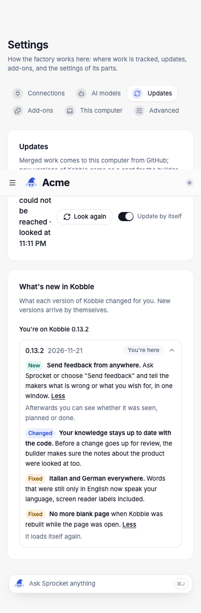

# What's new in Kobble

## Request

Card [#20 Changelog and updates list](https://github.com/danielplan/software-factory-core/issues/20), from exploration X-10: Settings › Updates gets **What's new in Kobble**, each release's changes in plain words and the team's language, read locally and, for a newer release, from GitHub.

Knowledge base: nothing to change, because the new section, route and files are described by `docs/releasing.md`, the design guide's new **Motion** section and `CHANGELOG.md`; no feature page or decision covers Updates.

## Decisions the plan left open

- **Date per release:** `## 0.13.2 (2026-11-21)` is allowed and shown when present.
- **Which releases:** all that have words; the newest open, the rest closed. A release with no section in any file is left out. Writing sections for older releases is for the makers (0.13.2 is written).
- **Newer release's files:** raw files at tag `release-<newest>` on `raw.githubusercontent.com`, kept per version in memory.
- **`checkedAt`/`offline`:** kept in a `status()` on `KobbleReleases` rather than in `ReleaseView`, so `GET /api/updates` is unchanged; the tags function now returns `null` when GitHub cannot be reached. `checkedAt` is the last attempt.
- **Left as is (as proposed):** the project card's Update button and switch, its offline line, the sidebar row; no new sidebar badge.

## Done

1. Files, format, release check, package: `packages/core/src/whats-new.ts` (+ tests), `WHATS-NEW*.md`, `scripts/whats-new-files.mjs`, `build-release.mjs`, `publish-release.mjs`.
2. Server: `packages/server/src/updates/whats-new.ts`, route in `served.ts`.
3. Page: `packages/dashboard/src/updates/whats-new.tsx` and `whats-new-model.ts`, words in `i18n/areas/whats-new.ts`.
4. Motion rules, animations, docs, changelog.

## Checked

`npm run verify` passes (format, lint, types, unused code, copy-paste, tests with coverage, docs). On the running product, Settings › Updates in English, wide and in a 420 px window, with More open:

Not looked at in the browser: the offline and newer-release states (the browser's request faking did not take; they are covered by the server and model tests), Italian and German on screen, reduced motion, and whether the motion feels gentle.
