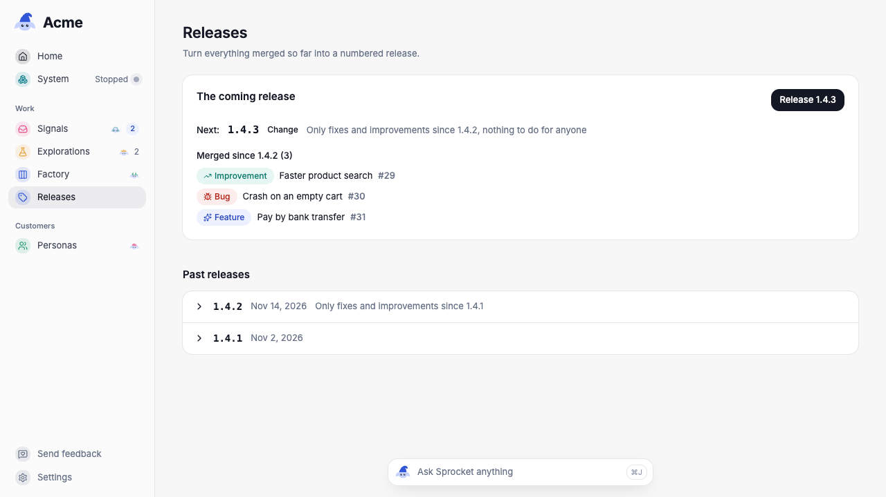
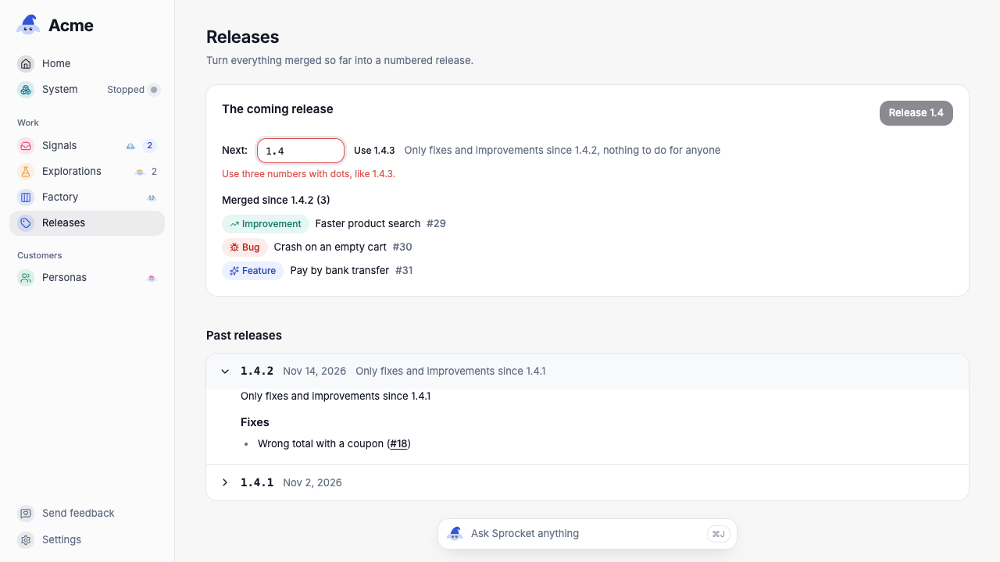

# Versions of our products: a Releases page (card #22)

## Request

[Card #22](https://github.com/danielplan/software-factory-core/issues/22),
agreed in Kobble (exploration X-6): a **Releases** page where the team turns
everything merged so far into a numbered release of its product, with the
number suggested by the kobold and notes written from the merged work.

## Plan and checks

1. Server, `packages/server/src/releases/`: `numbers.ts` (the rule),
   `notes.ts`, `github-releases.ts` (GitHub CLI: tags, past releases, merged
   pull requests, making a release), `judge.ts` (the kobold's yes or no and
   its reason), `routes.ts` (`GET`/`POST /api/releases`), wired in
   `kobble/served.ts`. Tests: `release-numbers.test.ts`, `releases.test.ts`.
2. Page: `PAGES`, sidebar, `PageBody`, `releases/releases-page.tsx`, words
   in `i18n/areas/releases.ts` (+ `pages.releases` in `shell`).
3. `CHANGELOG.md` line, docs, screenshots of each state.

Decisions (the plan left them open or cheap to change):

- Merged since the last release: pull requests whose merge commit is among
  the commits `compare/v<last>...<main>` lists. Exact, no date guessing.
- A card's type comes from the pull request's own label, else from the card
  (issue) whose number is in the branch `factory/issue-N`.
- The reason line is written by the kobold in the team's language. When it
  cannot answer, the last number is suggested without a reason and the page
  says so. The reason is kept in the release's notes as a hidden comment, so
  past releases show it.
- Nothing merged: the button is greyed out ("Nothing merged since 1.4.3"),
  and the server refuses too. First number 0.1.0; the kobold never raises
  the first number. One release for the whole repository; notes are not
  grouped by product (the proposal was optional, left out for now).
- Notes are our own (grouped by type label), not `--generate-notes`.

## Status

done: server, page, words (en, it, de), changelog. Not checked: the kobold's judgement on real work; a real release on GitHub.

Knowledge base: `docs/architecture.md` (new section "Releases of the products"), `docs/reference/design-system.md` (the one-click button and the suggested number) and `docs/releasing.md` (a pointer) say what was built.
