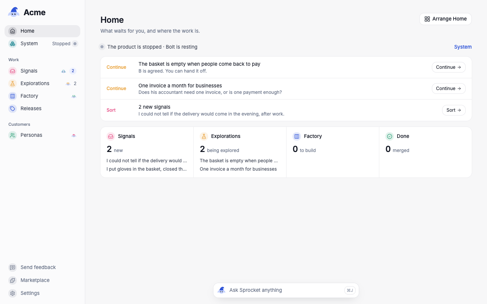
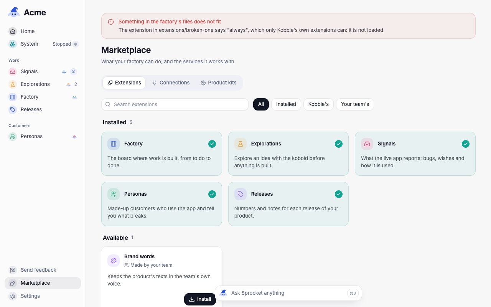
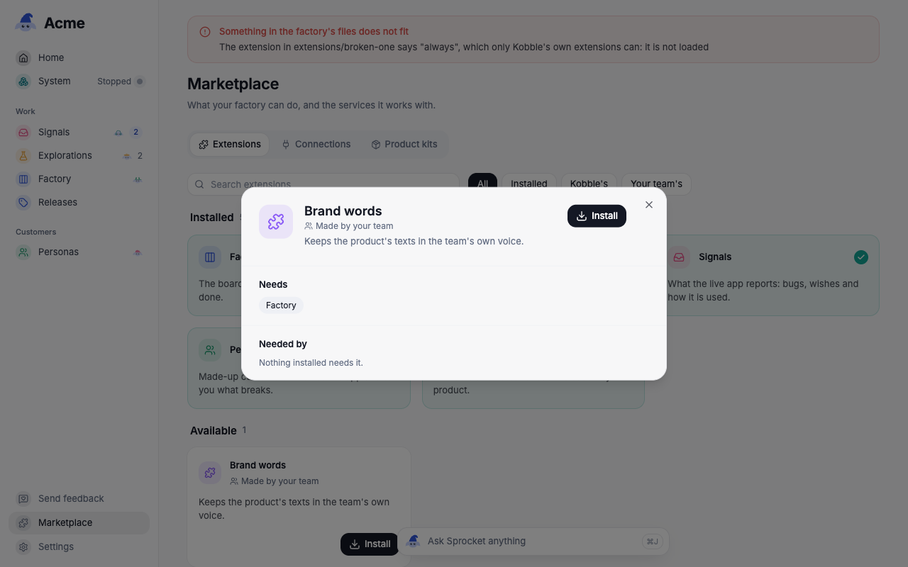
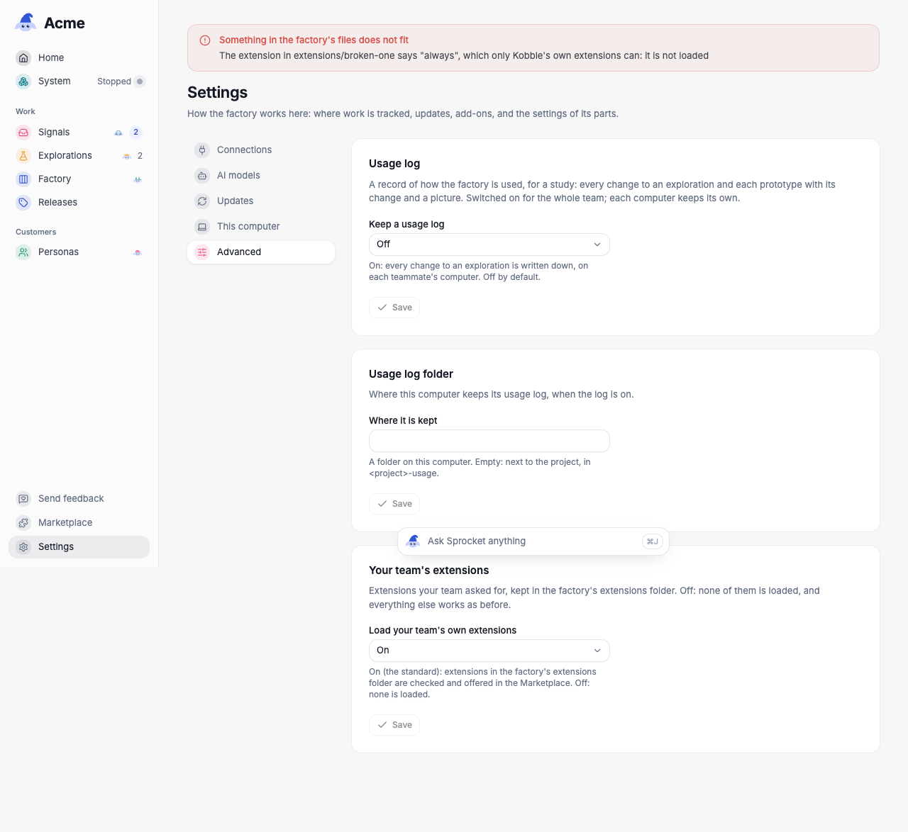
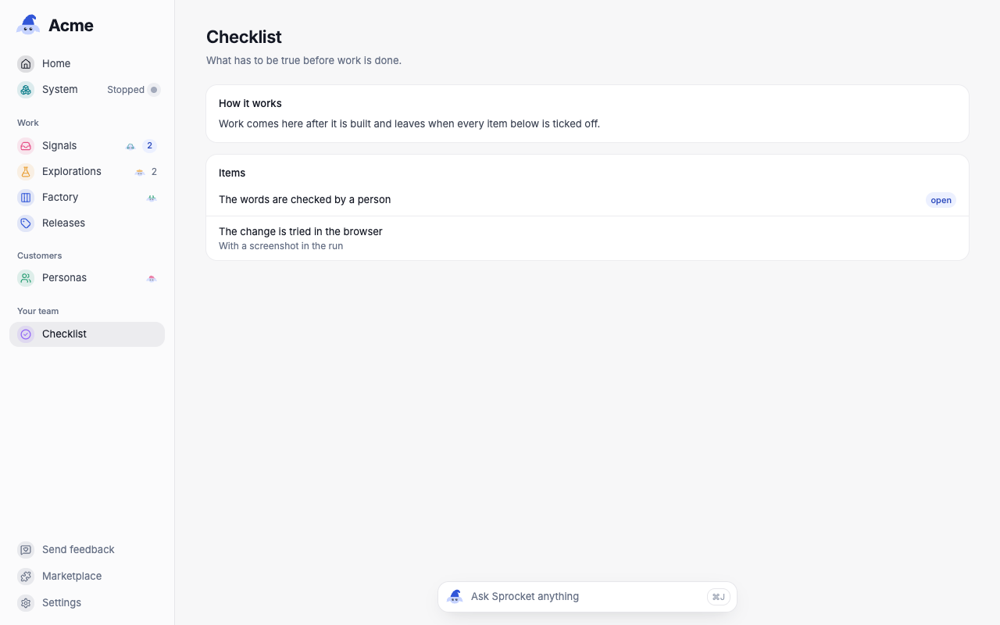
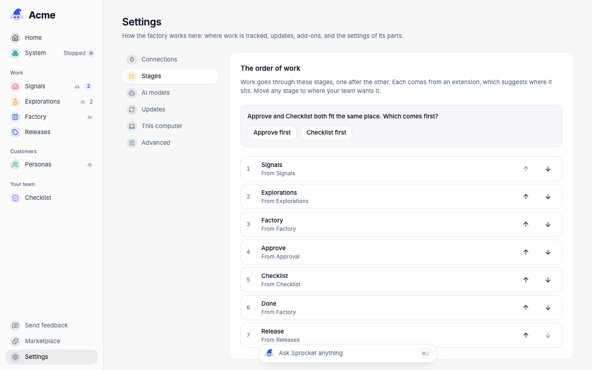
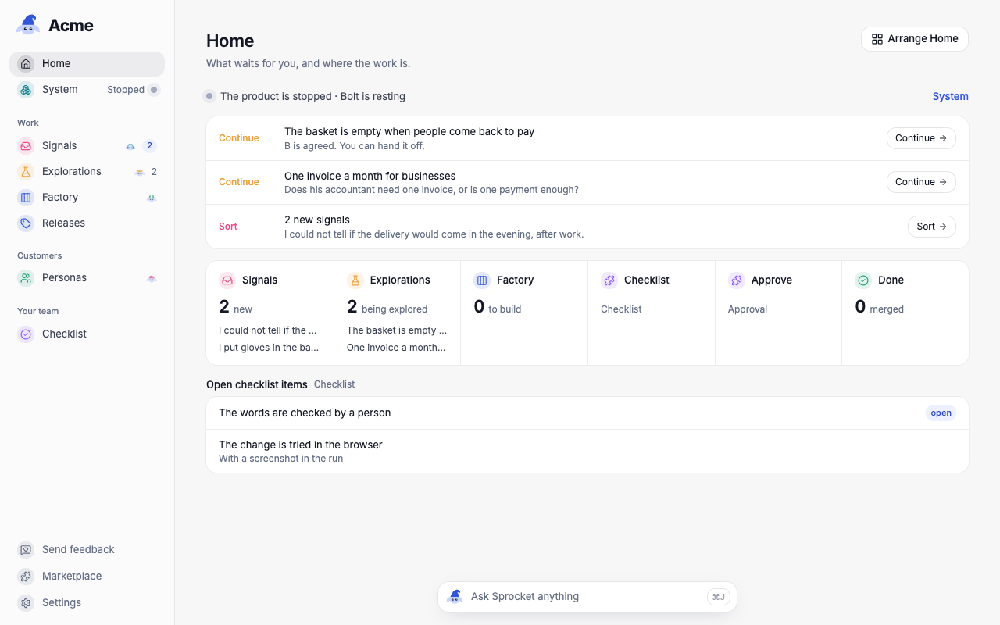
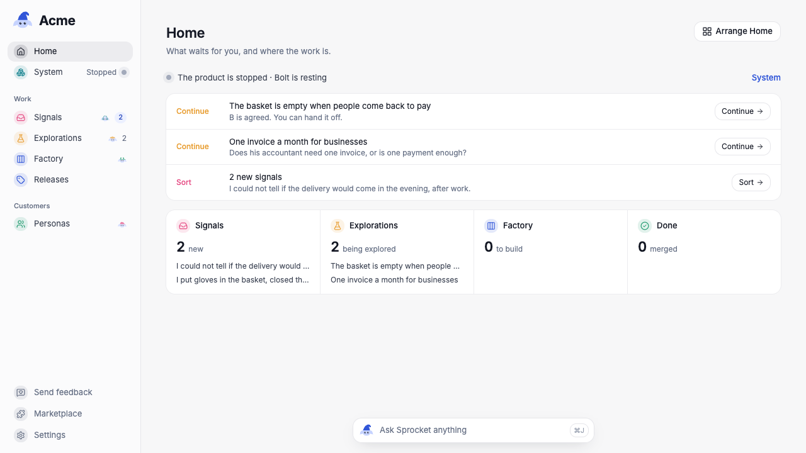

# Make your own extensions with the kobold (card #27)

## Request

[Card #27](https://github.com/danielplan/software-factory-core/issues/27),
agreed in Kobble (exploration X-12, prototype `proto/X-12-a`, variant B):
everything is an extension, a Marketplace for extensions, connections and
product kits, Home arranged from the blocks extensions bring, and a team's
own extensions asked for through Sprocket and written by the builder.

The prototype is read with `git show origin/proto/X-12-a:<path>`; variant B
is the build (`extensions/market-page.tsx`, `extensions/bits.tsx`,
`extensions/data.ts`, `dashboard/home-blocks.tsx`, `dashboard/home-page.tsx`,
`lib/use-flip.ts`, `home-layout.ts` and the motion at the end of
`index.css`). Its stand-ins are replaced as the card says: made-up
extensions, kits and products; opening on the Marketplace; the variant
switch and variants A and C; `.playwright-mcp/`; words in the screens.

## The steps (one release each; the card is too big for one)

1. **Extensions you can see and choose** (this is the first release).
   The extension gets what the Marketplace shows: what it brings (pages,
   Home blocks, kobolds), what it needs, whether it is always needed.
   Kobble's own pieces become extensions: Factory (always needed),
   Explorations, Signals, Personas, Releases. Installing brings what is
   needed; removing one others need is refused; Factory cannot go. The
   page follows: a removed extension's page leaves the sidebar. The
   Marketplace page (Extensions, Connections, Product kits, details
   dialog, search and filters) replaces Settings › Add-ons.
2. **Home from blocks.** Home is arranged from the blocks extensions bring:
   Arrange Home, Add a block (dialog, preview, drop line, keyboard), Reset
   layout, one Home for the team in `factory/home.json`.
3. **A team's own extension, and the slots.** The plug-in points for pages,
   stages and Home blocks; loading from `factory/extensions/`; the checks
   before loading; the guide and the starter; the builder allowed in that
   folder; the off switch in Settings; asking for one only through
   Sprocket; the slots (Your code, Your tasks) filled once at setup;
   stages from extensions, with neighbours and Settings asking on a clash.

Only the first two are meant for the first sessions; step 3 is the largest
and is not started when a session ends before it. Each session says in its
answer which of these are done, partly done or not started.

## Decisions (the plan left them open or cheap to change)

- A Kobble extension is `core: true`: installed unless the company lists it
  in `without` (the existing switch). Nothing is added to `factory.json`, so
  step 1 needs no migration; every extension that is on today stays on.
- Names, lines and what an extension brings are _words_: they come from the
  dashboard's catalogue by the extension's id (English, Italian, German);
  an extension the catalogue does not know (a team's own) shows the `name`
  and `about` of its own definition.
- GitHub and Jira stay extensions inside (they own routes, settings and
  programs) but the Marketplace shows them under Connections, not under
  Extensions. "Switch to Jira" asks first, then goes to the existing board
  connection on Settings: nothing is moved without connecting the new board.
- Kits are not extensions; their Marketplace cards come from `state.kits`
  and the products that use them.

- The Marketplace address is `#extensions` (tabs `#extensions/connections`,
  `#extensions/kits`); the old `#add-ons` and `#settings/add-ons` lead there.
  The Add-ons tab of Settings is gone: an extension's settings are in its
  details. Words: `i18n/areas/market-*.ts`, names and lines of Kobble's own
  extensions by id.
- The code connection is always GitHub, "In use": it is the only filler of
  the slot today. The board cards say In use by `company.tracker`.
- "Made by" for an extension: Kobble's when `core`, otherwise the team's;
  kits say `madeBy` (all Kobble's until step 3 loads a team's own).
- Installing asks first only when it brings others (as the prototype did).
- Differences from the prototype: the tabs are links (`#extensions/…`), so a
  reload stays on the tab; Switch to Jira asks, then goes to Settings ›
  Connections to connect it; no made-up extensions (Voice, Verification,
  Daily standup, Shopify theme) and no "Needs: GitHub CLI" line.

## Status

Step 1 is built and checked (tests, lint, types, dead code, docs; the
screenshots are in `issue-27-extensions-and-marketplace/`): extensions you
can see and choose, the Marketplace with its three tabs and the details
dialog, install with its confirm, remove with its confirm and refusals,
Factory always needed, pages leaving the sidebar.

Step 2 (Home from blocks) is built and checked: Arrange Home on the title
line; in arrange mode Reset layout (asks first), Add a block and Done, blocks
with a grip, move up and down, Hide, and the dashed slot at the end; the Add
dialog (installed extensions at the left, their blocks at the right, with a
preview and Add or "On Home"); the new block follows the pointer to a drop
line, with ↑ ↓ Enter and Esc for the keyboard; one Home for the team in
`factory/home.json` (GET and POST `/api/home-layout`, `server/src/home-layout.ts`).
Blocks: Factory's product line, what waits, the loop and open reviews;
Explorations' ideas being explored; Signals' new signals. Only blocks of
installed extensions show.

Decisions in step 2:

- No file means Home starts with today's blocks (status, waiting, loop), the
  others off Home: so no migration is needed, and nothing for a company to do.
- The file keeps blocks by id and only checks their shape, so a block of a
  removed extension stays in the file and returns with it; a block an
  extension brings later is added off Home.
- Differences from the prototype: no made-up "Failed check" block (from the
  made-up Verification extension) and no made-up waiting items; the empty
  states are real; blocks wait for the layout and for what they show, and
  come in place with no motion on first load (the team's later change to the
  prototype); the motion is only for what the person does (move, add, hide).
  The words of the blocks and of arranging are in the catalogue
  (`home.arrange`, `home.blockAbout`, `home.blockEmpty`, EN, IT, DE).
- Not tried in the browser: dragging a block with the mouse (the move
  buttons, hiding and the keyboard were); it is the prototype's code.

Step 3 (a team's own extension, and the slots) is partly done. Built and checked
(tests, lint, types, dead code, duplicates, docs; looked at in the browser):

- **Loading from `factory/extensions/<id>/extension.json`**
  (`core/src/extensions/team.ts`). An extension of the team is a description,
  never code that runs. **The checks before loading** (the open point,
  decided here): the file reads and fits the description with no word it does
  not know; it does not say `core`, `always`, `tracker` or `parts` (only
  Kobble's own may: so nothing unknown starts a program); its id is its
  folder's name and not another extension's; it does not bring a page, block
  or kobold another brings; its guide files are inside its own folder; its
  settings are only in `team.env` or `settings/`. One that fails is left out,
  with a plain line among the factory's problems, and never stops the others.
- **The same checks before a pull request**: a branch that changes
  `factory/extensions/` fails the builder's checks when an extension in it
  would be refused (`extensionsReport`), so the builder fixes it first.
- **Off switch**: Settings › Advanced › "Your team's extensions" (`team.env`,
  on by default); off loads none, saving it reads the factory again.
- **In the Marketplace**: the team's extensions are Available (or Installed)
  with "Made by your team", installed and removed like the others
  (installing is the review's second step: the pull request is the first).
- **The guide**: the factory skill's `extensions.md`; Sprocket's guide says a
  team asks for an extension only through its chat (as an exploration) and
  that pages and Home blocks cannot come from one yet. An installed
  extension's guides for the builder reach the builder's prompt.
- **The builder is allowed in the factory's folder**: nothing forbade it (it
  works in the whole copy); the folder is committed like any other.

(The first picture also shows a second, broken extension left out, with why.)

Decisions in step 3: no migration (no folder means nothing to load, the
switch is on until turned off); the extension starter is not made yet.

Step 3, second part (built and checked: tests, lint, types, docs; looked at in
the browser on a made-up factory with two team extensions):

- **Team pages and Home blocks.** Described, not coded: `pages` and `blocks` in
  `extension.json`, each with a name, a line, an icon and parts (text, or a
  list kept in the description or in a JSON file of the extension's folder,
  read each time it is shown). Kobble's page draws them with its own
  components (`screen-view.tsx`), so they look like Kobble's. Pages are in the
  sidebar under "Your team" (`#team/<id>`), blocks come with Arrange Home ›
  Add a block like any other. Decision: this reads "built into Kobble's page
  when the factory starts" as "drawn by Kobble's own components from the
  description the factory reads when it starts", because a team's extension
  never runs code (the first safety rule). Checks added: a page or block is
  described when brought, no page that is Kobble's frame, list files inside
  the folder and a JSON list of items.
- **The extension starter** (`factory/extension-starter/`: a page, a Home
  block, a stage and a guide, loads as it is: a server test copies it and
  loads it). Open point decided: it does **not** use Verification as its
  example. Verification may become a Kobble extension of its own, and a
  starter's example id would clash with it; the example is a made-up
  "Checklist".
- **Stages from extensions.** `stages` in the description (id, name, `after`,
  `before`); `orderStages` works the order out; two stages for one place (or
  each after the other) are a clash that Settings › Stages (a new tab) asks
  the team about; the team can move any stage; the answer is in
  `factory/stages.json`. Kobble's own stages (signals, explore, build, done,
  release) name their neighbours, so they are a chain with nothing open.
  Home's loop follows the order and shows a team's stage without a count.
  Personas no longer brings the stage "signals" (Signals does).
- **The slots.** `fills` on an extension (GitHub fills Your code, a tracker
  fills Your tasks); `slotsOf` says who can fill each and who does (the
  company's tracker for tasks), the Connections tab reads it. An installed
  extension that uses a slot nothing fills stops the factory. A team's own
  extension cannot say `fills`. No migration: the board a company already
  connected is the filler, so the slots are filled from today's files.
- **Settings' line** no longer says add-ons.

Step 3, third part (built and checked: the full `npm run verify` passes, 569
tests; looked at in the browser):

- **The piece of work** (first built as its own pieces in `factory/work.json`;
  see "The card is the piece of work" below, which replaces that): id, title, stage, the checks
  of its stage that have passed, a history of every move, and a part per
  extension. `moveWork` goes to the next stage only when every check of the
  stage it is in has passed, one stage at a time; going back needs none and
  starts that stage's checks again. A stage names its `checks` in the
  extension (words, not code; the starter has one). The server keeps the pieces
  in `factory/work.json` and answers `/api/work-pieces` (list, start, check,
  move; `server/src/work-book.ts`); a move is told to the page and to any
  listener the server is given (`Moved`). Home's loop shows a team's stage with
  how many pieces are in it.
- **Home lets go of a block** no extension brings any more (a team's extension
  whose folder is gone) when Home is next saved; a block of an extension that
  is only not installed stays.
- **The setup coach** names the two slots, Your code and Your tasks, in its
  guide.

Decisions: a check is a name that a person or the extension's kobold marks as
passed, because a team's extension never runs code.

## The card is the piece of work (the owner's change, session 5)

The owner asked: make the board card the piece of work, the only one for now;
a card has a stage and a history; it can only move on from a team's stage when
that stage's checks pass; Kobble's own stages stay as they are, with no checks;
drop `factory/work.json`; and a migration that gives each existing card its
stage from where it sits today.

- **Built.** `core/src/work/work.ts`: `pieceOf` makes the card a piece of work
  (`OnBoard` is what the board says of it); `cardCourse` is what a card can go
  through (Build, a team's stages between Build and Done, Done: Kobble's other
  stages hold no card); `moveWork`, `passCheck` and `openChecks` are as before;
  `startWork` is gone (a card is already there). `server/src/work-book.ts`
  answers `/api/work-pieces` (list, check, move) from the board's cards; the
  file `factory/work.json` and its reading are gone. Home counts a team's
  stage from the cards (`CardView.held`), not from the server.
- **Where a card keeps its piece of work** (decided here, cheap to change): the
  team's stage as a label on the card (`stage: checklist`, like `type: bug`),
  so every list of cards carries it with no extra reading; the checks that
  passed, the history and the extensions' parts in a marked section of the
  card's text (`<!-- factory:work … -->`, as the agreed plan is kept), so
  whoever runs the factory on another computer reads them. What a card kept
  counts only for the stage it kept it in. `Cards.keepWork` writes both
  (GitHub today).
- **Kobble's stages stay.** A card with no label is in Build, or in Done when
  its column is Done or it is closed; moving it between columns is the board's,
  with no checks. A move into Done through the work route also moves the
  column to Done; a move out of Done puts it in Review; a closed card does not
  move. A team's stage that is gone (its extension removed) lets its cards go
  back to Build.
- **"Move into" or "move on from".** The hint says a card "can only move into a
  team's stage when that stage's checks have passed". The card's own words are
  "work moves on only when that stage's checks pass", and the core's rule since
  the last session is that a stage's checks must pass to leave it. I kept
  that: a card is stopped from leaving a team's stage until its checks pass.
- **The migration: none, and why.** Every card already has its stage from where
  it sits today: a card with no label is where its board column puts it, so
  nothing is stored, nothing has to be moved, and a company has nothing to do.
  A migration could not do more: migrations run on the factory's files, and
  the cards are on the tracker (writing a label on every card at upgrade would
  need the network, and would say what the column already says). The file
  `factory/work.json` was only ever in this unreleased branch, so no company
  has one to move away from.
- **Differences from the pieces before:** no "start a piece of work" (a card
  starts as a card); the history starts at the first move through the work
  route (the board's own column moves are not in it).
- **Checked:** tests (579, coverage thresholds met), lint, types, dead code,
  duplicates. The GitHub stand-in of the card tests now remembers labels. Not
  tried against a real board, and not looked at in the browser again: Home's
  count looks as in `home-work-in-stage.png`, and its numbers come from the
  cards' labels (a dashboard test).

**Not done** (for cards of their own):

- No screen moves a card into a team's stage or ticks its checks (the routes
  and Home's count are there); a screen was not in the agreed plan.
- No extension of Kobble's listens to a move yet.
- The setup coach has no tool of its own to fill Your code (GitHub is the only
  filler); Your tasks is filled by connecting the board, as before.
- Only a GitHub board can keep a card's piece of work (the only tracker with
  cards for now).
