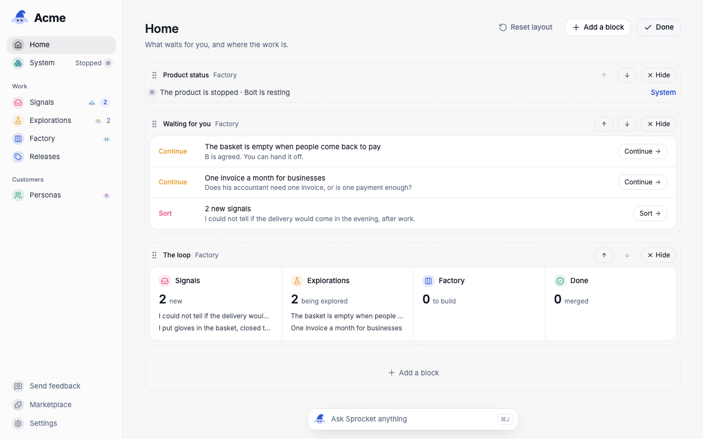
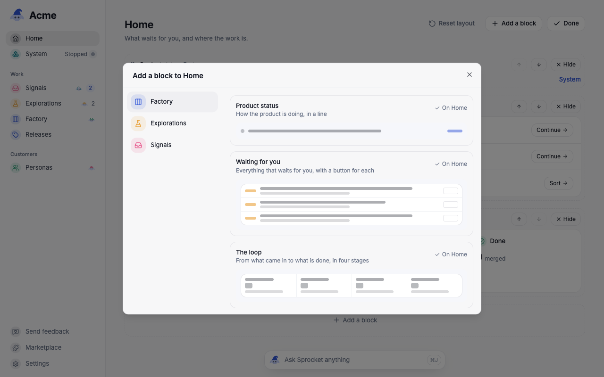
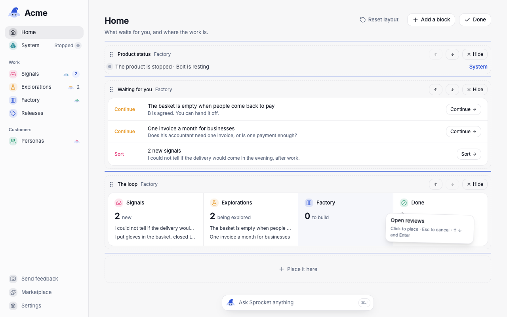
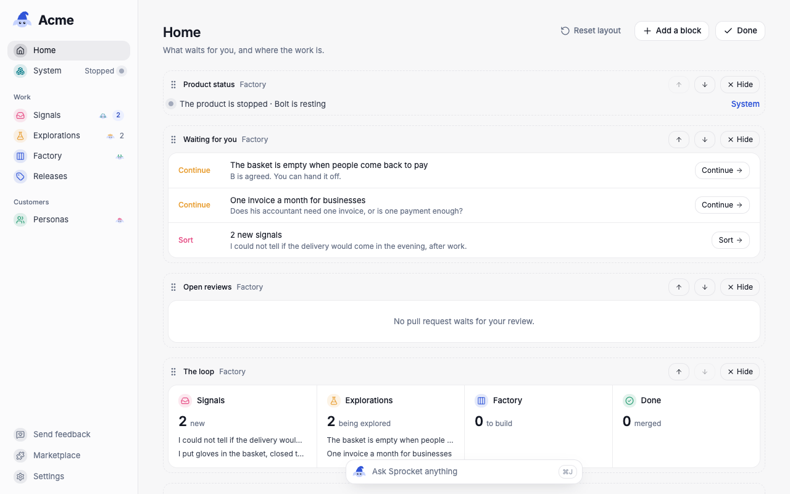
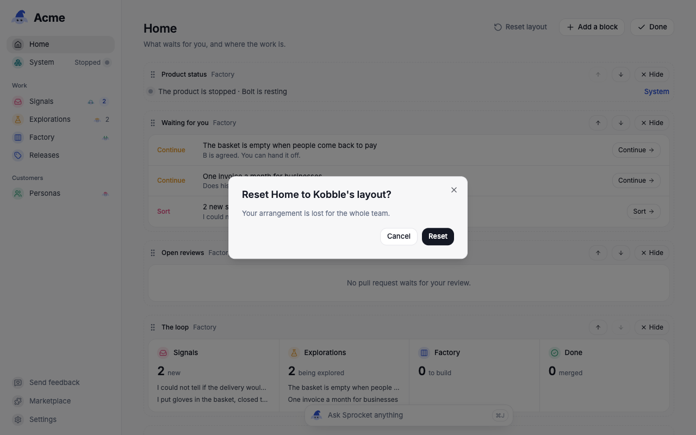

# Make your own extensions with the kobold (card #27)

## Request

[Card #27](https://github.com/danielplan/software-factory-core/issues/27),
agreed in Kobble (exploration X-12, prototype `proto/X-12-a`, variant B):
everything is an extension, a Marketplace for extensions, connections and
product kits, Home arranged from the blocks extensions bring, and a team's
own extensions asked for through Sprocket and written by the builder.

The prototype is read with `git show origin/proto/X-12-a:<path>`; variant B
is the build (`extensions/market-page.tsx`, `extensions/bits.tsx`,
`extensions/data.ts`, `dashboard/home-blocks.tsx`, `dashboard/home-page.tsx`,
`lib/use-flip.ts`, `home-layout.ts` and the motion at the end of
`index.css`). Its stand-ins are replaced as the card says: made-up
extensions, kits and products; opening on the Marketplace; the variant
switch and variants A and C; `.playwright-mcp/`; words in the screens.

## The steps (one release each; the card is too big for one)

1. **Extensions you can see and choose** (this is the first release).
   The extension gets what the Marketplace shows: what it brings (pages,
   Home blocks, kobolds), what it needs, whether it is always needed.
   Kobble's own pieces become extensions: Factory (always needed),
   Explorations, Signals, Personas, Releases. Installing brings what is
   needed; removing one others need is refused; Factory cannot go. The
   page follows: a removed extension's page leaves the sidebar. The
   Marketplace page (Extensions, Connections, Product kits, details
   dialog, search and filters) replaces Settings › Add-ons.
2. **Home from blocks.** Home is arranged from the blocks extensions bring:
   Arrange Home, Add a block (dialog, preview, drop line, keyboard), Reset
   layout, one Home for the team in `factory/home.json`.
3. **A team's own extension, and the slots.** The plug-in points for pages,
   stages and Home blocks; loading from `factory/extensions/`; the checks
   before loading; the guide and the starter; the builder allowed in that
   folder; the off switch in Settings; asking for one only through
   Sprocket; the slots (Your code, Your tasks) filled once at setup;
   stages from extensions, with neighbours and Settings asking on a clash.

Only the first two are meant for the first sessions; step 3 is the largest
and is not started when a session ends before it. Each session says in its
answer which of these are done, partly done or not started.

## Decisions (the plan left them open or cheap to change)

- A Kobble extension is `core: true`: installed unless the company lists it
  in `without` (the existing switch). Nothing is added to `factory.json`, so
  step 1 needs no migration; every extension that is on today stays on.
- Names, lines and what an extension brings are _words_: they come from the
  dashboard's catalogue by the extension's id (English, Italian, German);
  an extension the catalogue does not know (a team's own) shows the `name`
  and `about` of its own definition.
- GitHub and Jira stay extensions inside (they own routes, settings and
  programs) but the Marketplace shows them under Connections, not under
  Extensions. "Switch to Jira" asks first, then goes to the existing board
  connection on Settings: nothing is moved without connecting the new board.
- Kits are not extensions; their Marketplace cards come from `state.kits`
  and the products that use them.

- The Marketplace address is `#extensions` (tabs `#extensions/connections`,
  `#extensions/kits`); the old `#add-ons` and `#settings/add-ons` lead there.
  The Add-ons tab of Settings is gone: an extension's settings are in its
  details. Words: `i18n/areas/market-*.ts`, names and lines of Kobble's own
  extensions by id.
- The code connection is always GitHub, "In use": it is the only filler of
  the slot today. The board cards say In use by `company.tracker`.
- "Made by" for an extension: Kobble's when `core`, otherwise the team's;
  kits say `madeBy` (all Kobble's until step 3 loads a team's own).
- Installing asks first only when it brings others (as the prototype did).
- Differences from the prototype: the tabs are links (`#extensions/…`), so a
  reload stays on the tab; Switch to Jira asks, then goes to Settings ›
  Connections to connect it; no made-up extensions (Voice, Verification,
  Daily standup, Shopify theme) and no "Needs: GitHub CLI" line.

## Status

Step 1 is built and checked (tests, lint, types, dead code, docs; the
screenshots are in `issue-27-extensions-and-marketplace/`): extensions you
can see and choose, the Marketplace with its three tabs and the details
dialog, install with its confirm, remove with its confirm and refusals,
Factory always needed, pages leaving the sidebar.

Step 2 (Home from blocks) is built and checked: Arrange Home on the title
line; in arrange mode Reset layout (asks first), Add a block and Done, blocks
with a grip, move up and down, Hide, and the dashed slot at the end; the Add
dialog (installed extensions at the left, their blocks at the right, with a
preview and Add or "On Home"); the new block follows the pointer to a drop
line, with ↑ ↓ Enter and Esc for the keyboard; one Home for the team in
`factory/home.json` (GET and POST `/api/home-layout`, `server/src/home-layout.ts`).
Blocks: Factory's product line, what waits, the loop and open reviews;
Explorations' ideas being explored; Signals' new signals. Only blocks of
installed extensions show.

Decisions in step 2:

- No file means Home starts with today's blocks (status, waiting, loop), the
  others off Home: so no migration is needed, and nothing for a company to do.
- The file keeps blocks by id and only checks their shape, so a block of a
  removed extension stays in the file and returns with it; a block an
  extension brings later is added off Home.
- Differences from the prototype: no made-up "Failed check" block (from the
  made-up Verification extension) and no made-up waiting items; the empty
  states are real; blocks wait for the layout and for what they show, and
  come in place with no motion on first load (the team's later change to the
  prototype); the motion is only for what the person does (move, add, hide).
  The words of the blocks and of arranging are in the catalogue
  (`home.arrange`, `home.blockAbout`, `home.blockEmpty`, EN, IT, DE).
- Not tried in the browser: dragging a block with the mouse (the move
  buttons, hiding and the keyboard were); it is the prototype's code.

Step 3 is not started.
