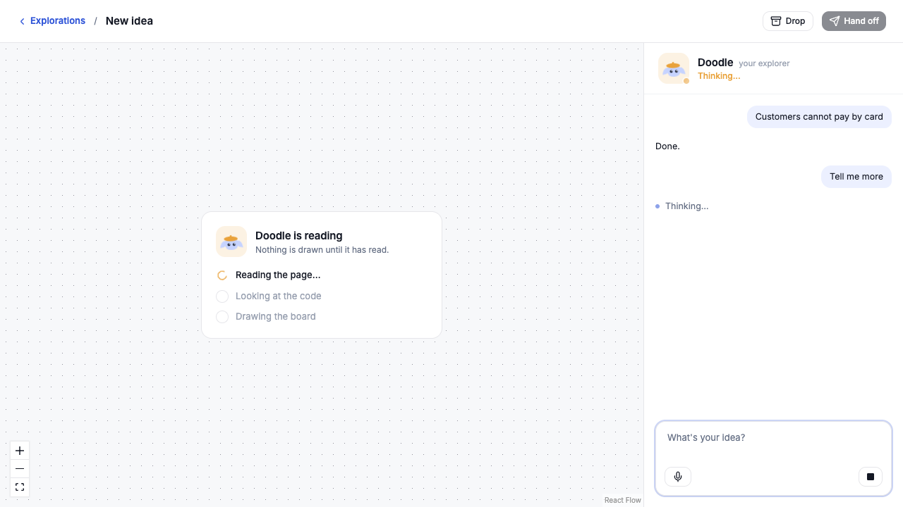
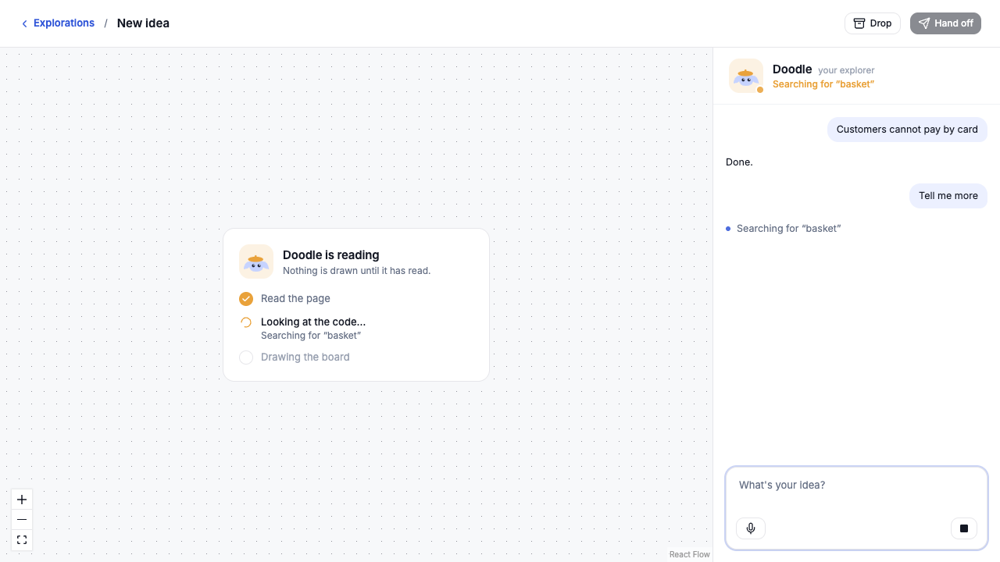
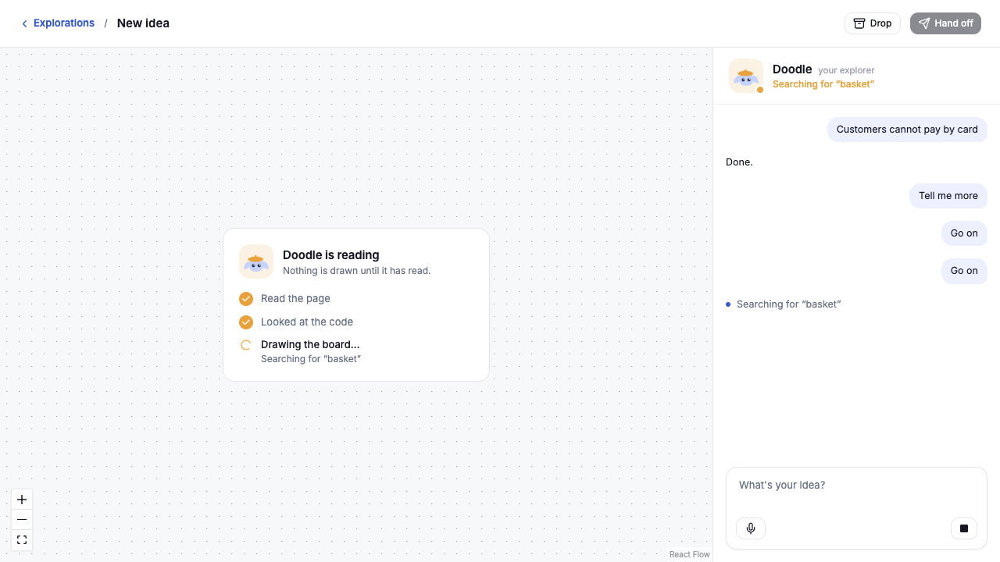
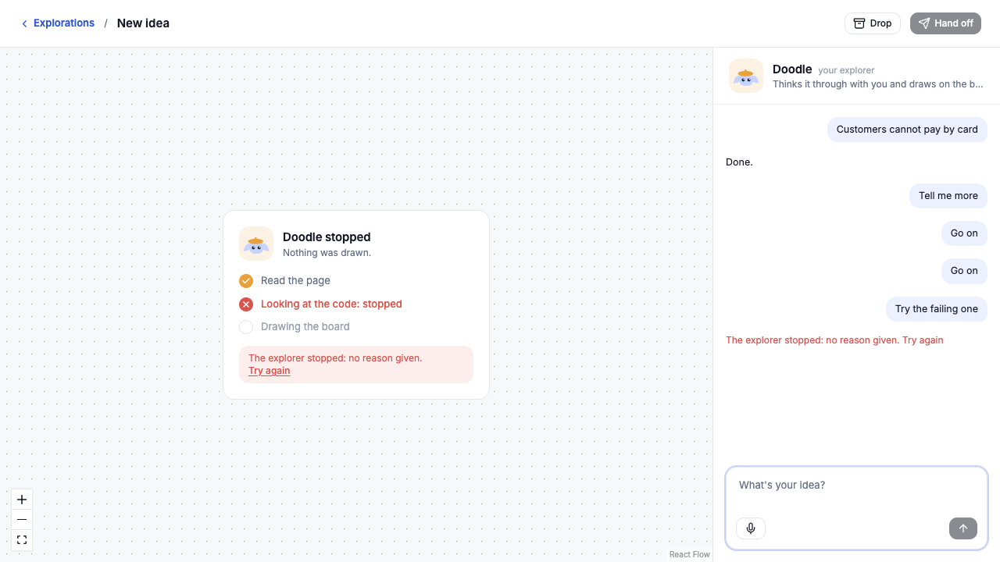
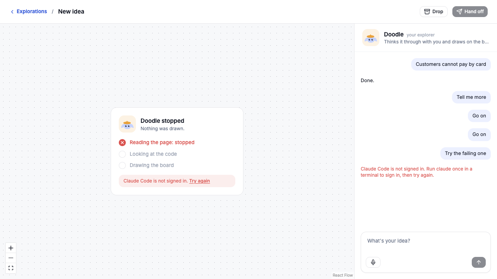

# A board that shows it's working (card #49)

## Request

[Card #49](https://github.com/danielplan/software-factory-core/issues/49),
agreed in exploration X-16 (prototype `proto/X-16-a`, variant A, built on
the steps of variant B): while the explorer reads, the empty board shows a
card with its steps, ticked as the explorer reports them; when it really
stops, the card says where and why and offers "Try again". Products:
Kobble's page and Kobble's server.

## Plan and checks

Built from the prototype's `reading-board.tsx`, keeping its look, with
the prototype's stand-ins replaced:

- The seconds timer and the made-up stop (`prototype-run.ts`,
  `prototype-switch.ts`, the jump to X-0, `?variant=` and `state=stopped`)
  are left out, and so are variants B, C and D.
- **Steps from reports.** `Talk` (`coach/talk.ts`) keeps `step` for the turn:
  0 reading what it was given, 1 once Claude Code reports reading or
  searching, 2 once it uses a drawing tool. The explorer's talk view
  carries it (`talk-view.ts`, new, to keep `talks.ts` under its size limit).
- **Reason.** `Talk` takes `who`, so the explorer's failure reads "The
  explorer stopped: …". The page says it in the language shown
  (`stopWords`, `server-texts.ts`), short on the card, with its next step in
  the chat.
- **Try again.** `POST /api/kobble/explorations/again` takes the owner's last
  words back (nothing came after them, the answer failed) and says them
  again, so the chat has them once; with no words yet, it is the explorer's
  first look again.
- Words: `explore.reading.*` and `explore.stopped.*` in en, it, de.
- Tests: `talk-steps.test.ts` (server), `reading-card.test.ts` (page).
- Docs: the explorations feature page.

Decisions (cheap to change, decided here):

- **Open point: steps on a board that already has things?** Only on the
  empty board, as the card says ("adds a reading card to the empty
  exploration board"). A busy board shows Doodle's work in the chat, as
  before.
- **Open point: which reports tick which step?** Reading or searching
  (`Reading …`, `Searching …`, `Looking …`, the lines the talk already
  shows) tick "Reading the page" and start "Looking at the code"; a
  drawing tool of the explorer (`add_note`, `add_diagram`, `add_choice`,
  `change_thing`, `link`, `make_prototype`) ticks "Looking at the code" and
  starts "Drawing". The page itself is what the explorer is given in its
  prompt, so it is read until the first look at code.
- The card is shown by its own rule (`readsTheBoard`), not by the
  prototype's: an empty board, not waiting, answering or stopped.
- No migration: nothing a company writes or runs changes.
- Try again does not keep what the owner had attached from the board with
  their last words (the page does not keep them after sending).

## Status

done

## Result

Looked at in the browser on this copy's own ports, with a pretend Claude
Code (a script that prints what the real one prints) so the steps and the
stops could be made to happen:

- Found by looking: the board always holds the problem note, so "empty"
  means "nothing but the problem" (`readsTheBoard`); the prototype's made-up
  exploration had no things at all.
- Found by looking: Claude Code's MCP tools reach the talk as "Using add
  choice (setup)", not as the full tool name, so the steps read both forms.
- Try again worked: the steps started over and the owner's words stayed once
  in the chat.
- Differences from the prototype: the card's words come from the
  translations; the reason line wraps "Try again" to a second line when the
  reason is long (as in the prototype); the chat shows the reason with what
  to do next, translated.
- Not looked at: a real Claude Code (it was a pretend one), the card in
  Italian and German on screen (the words are tested), a board that fills
  after the card (the pretend explorer does not draw).

## Later

- The coach's tool lines (`TOOL_LINES` in `coach/talk.ts`) match the full
  tool name, which Claude Code's events never carry, so they never show.
