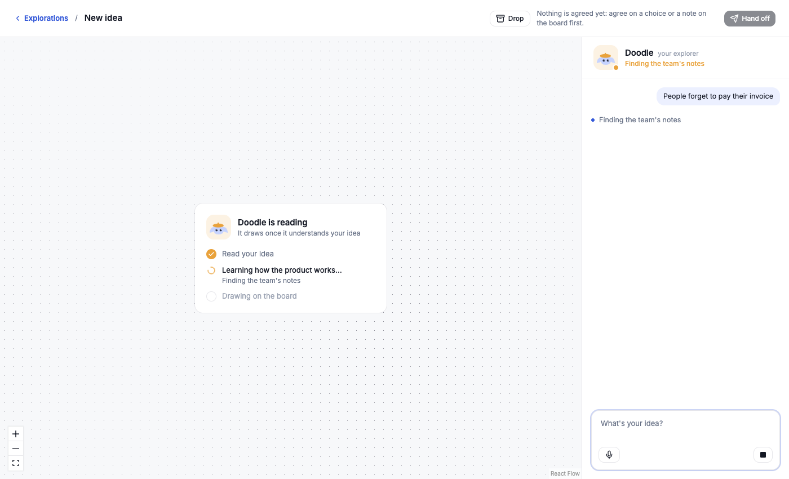
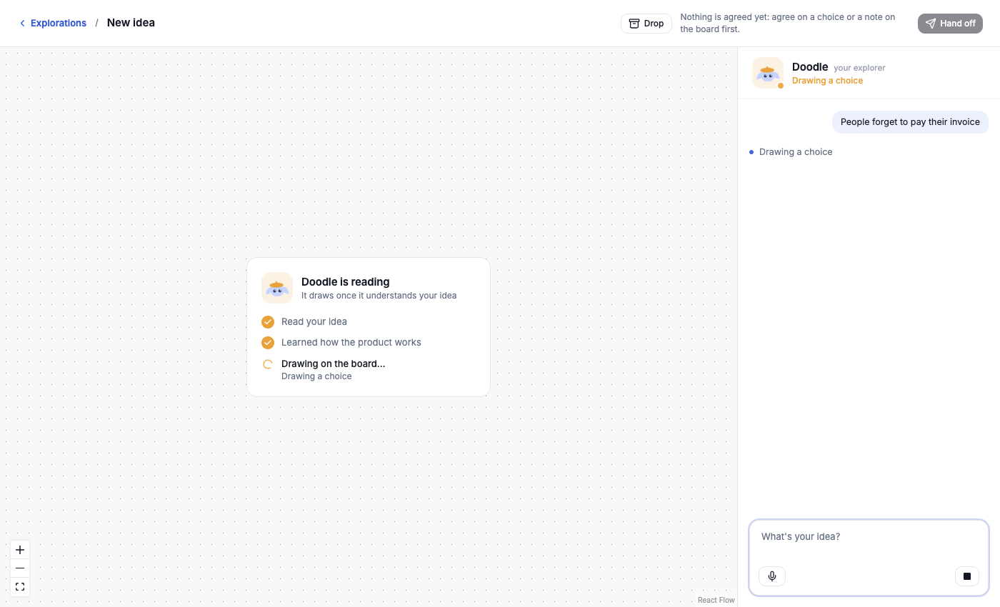
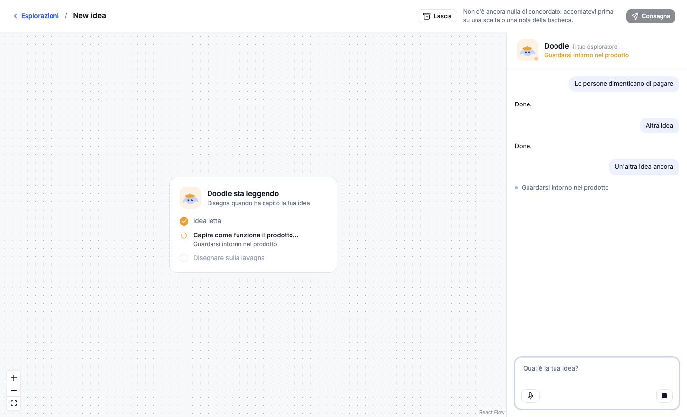
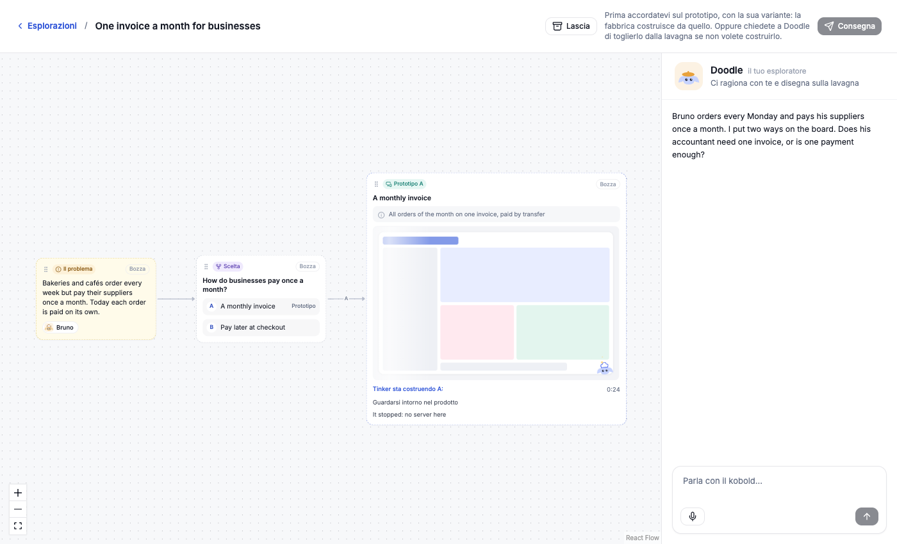

# What the kobold is doing, in plain words (card #55)

## Request

[Card #55](https://github.com/danielplan/software-factory-core/issues/55),
agreed in exploration X-18 (prototype `proto/X-18-a`, variant A): while Doodle
works on an idea, the board card, the chat and the header say the same
everyday step, in English, Italian or German; Tinker's line while it makes a
prototype gets the same words. Products: Kobble's page and Kobble's server.

## Plan and checks

Built from the prototype's variant A (`doing.tsx`, `reading-board.tsx`,
`talk-panel.tsx`, `explorer-header.tsx`), keeping its look and its words.
Left out: variants B and C, the variant switch, `?variant=`/`?state=` and the
made-up page (`made-up.ts`), and the branch's unrelated changes.

- **A fixed word list, not Doodle's own.** The server sorts, the page words.
  `doingOf` (core, `kobble/doing.ts`) puts each action line into a kind
  (`DOING_KINDS`) by what it touches; `Talk.doing` and the maker's run
  (`VersionRun.doing`) carry the kind, never English. The page words it
  (`explore.doing.*`, en/it/de) through `use-doing.ts`.
- **Stage by kind.** `stageOf`: the first read or search moves the turn to
  "Learning how the product works", the first drawing to "Drawing on the
  board" (`Talk.step`, as before).
- **Drawing actions reach the page.** Before, they were dropped from the
  activity line; now they are kinds (`draw-choice`, `draw-note`, …).
- **Everyday words on the card:** stages "Reading your idea" → "Learning how
  the product works" → "Drawing on the board", hint "It draws once it
  understands your idea".
- **A few seconds per step.** `Steady` (`steady.ts`) holds each step (and its
  stage with it) for 3 s on the page; the three places read one shared value,
  so they change together. A turn opens on "Getting ready", never on
  "Thinking…" (the old `explore.talk.thinking` is gone).
- **Must not change:** the Factory's step list (builder `steps`) and the
  coaches' lines (`Talk.activity`) are untouched; the maker's raw
  `activity` stays for the kobold who talks with the team.
- Tests: `core/test/doing.test.ts` (each kind, unknown, own words, stages),
  `dashboard/test/doing-words.test.ts` (every kind has words in en/it/de, no
  "code/files/page/description"; the hold), `server/test/talk-steps.test.ts`
  (kinds, drawing reaches the view, maker run).
- Docs: the explorations feature page.

Decisions (cheap to change, decided here):

- **Open point, "Getting to know the product" under "Reading your idea".** It
  no longer happens: reading the product's settings is a read, and the first
  read moves the stage to "Learning how the product works", so that step
  always sits under it. Stage 1 steps all fit its name. Under "Reading your
  idea" only "Getting ready", "Asking a helper" or "Looking around the
  product" can show.
- **One plain step under the stage** (as the prototype); not a list.
- **Tinker's words** (not listed on the card): editing "Changing the
  prototype", writing "Adding to the prototype", tests "Trying that it
  works", style/type checks "Checking its work", install "Getting what it
  needs", build "Putting it together", browser "Looking at it in the
  browser", git "Saving its work", to-do list "Planning its next steps",
  any command "Working on it". Starting up (all three "starting" lines) is
  "Getting ready". Unknown actions: "Looking around the product".
- **Screen files** are `.tsx/.jsx/.css/.html` (the prototype also counted
  `.ts`, which is not a screen).
- No migration: nothing a company writes or runs changes.

## Status

done.

## Result

Tried in a browser on a demo server whose Claude reports a scripted run of
actions (the real Claude Code was not used):

Not compared side by side with `?variant=A` of the prototype: the prototype
branch's page needs the old made-up state; the words, stages and layout are
taken from its code unchanged.

## Later

- The German page was not opened in the browser (words checked by the
  tests only).
- The coaches' (setup and ideas) and the support kobold's lines still show
  Claude Code's raw English lines.
