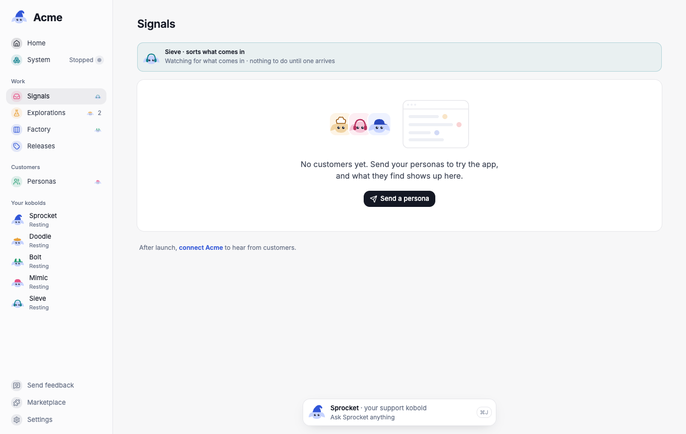
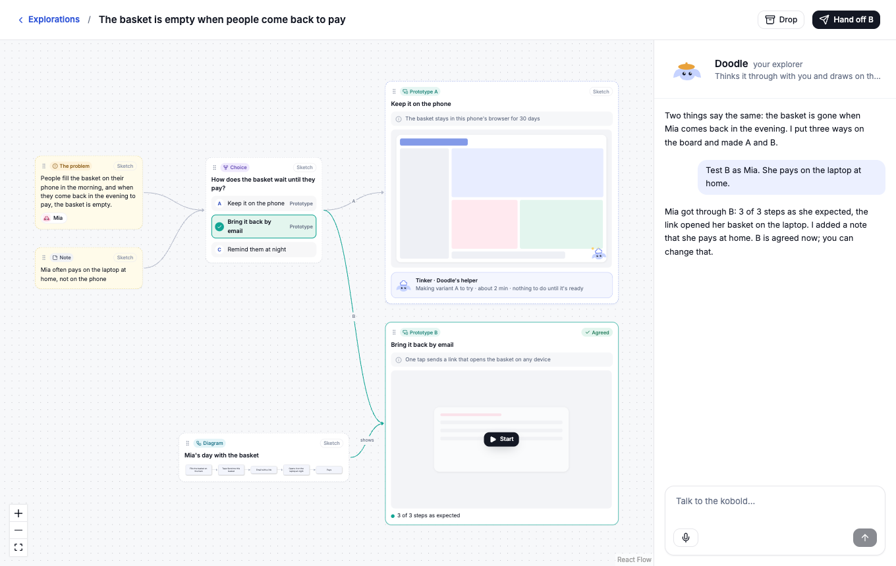
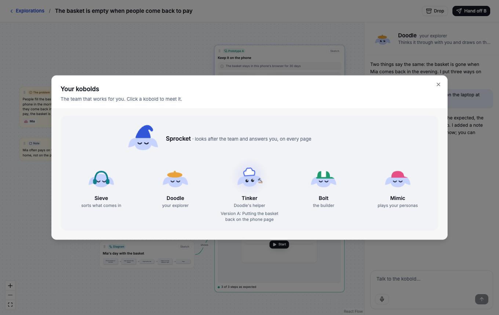
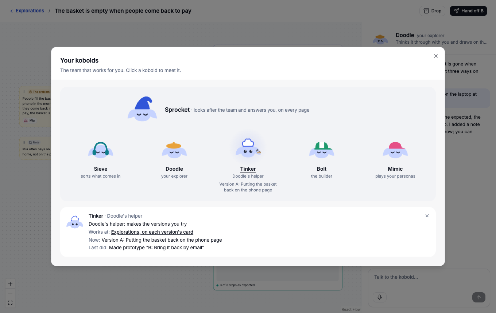
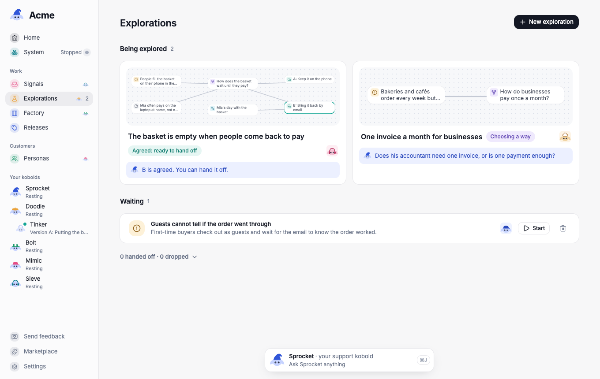
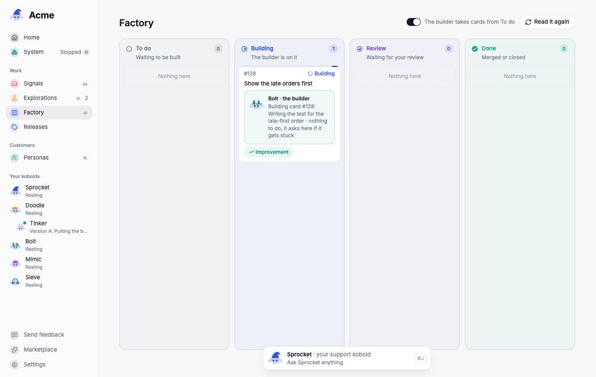
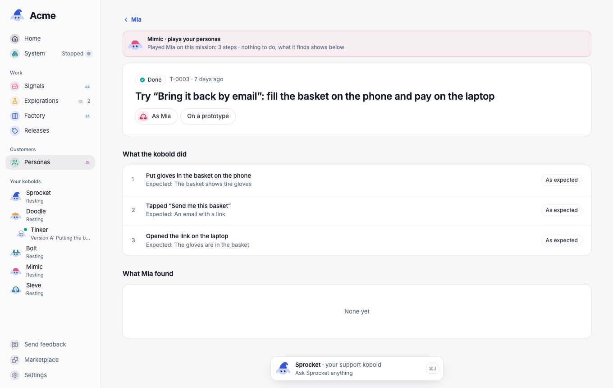

# Meet the kobolds (card #59)

## Request

[Card #59](https://github.com/danielplan/software-factory-core/issues/59),
agreed in exploration X-19 (prototype `proto/X-19-a`, variant E): the page
shows each kobold where it works, with its name, role and what it does for
you, and a "Your kobolds" panel to meet the whole team. Today the kobolds
are tiny sidebar faces and people do not know who "Tinker" is when Doodle
names it.

## Plan and checks

Built from variant E of the prototype (its name tags, its sidebar group, its
panel and workshop, its look). Left out: variant A (white panel), the variant
switch, `?state=`, the made-up Bolt card and Tinker run, opening on
`#explore/X-1`, the made-up activities. The restructuring in Tinker's copy
(docs, setup files) stays as on main.

Page (`packages/dashboard`):

1. `lib/kobolds.ts`: `TEAM` (the five kobolds plus Tinker, in the panel's
   order) next to `KOBOLDS`.
2. `lib/meet.ts`: the small store of what each kobold does now and last
   (reported by the extensions) and the panel (open, which kobold is lit).
   `lib/meet-view.ts`: the rules, kept apart from the components so they are
   checked on their own (the live line for each state, Tinker only while it
   works, lit, working or resting).
3. `components/meet/`: `name-tag.tsx`, `kobold-group.tsx` (sidebar),
   `team-panel.tsx` (+ `Face`), `workshop.tsx` (the scene).
4. A new plug, `ExtensionPage.Watch`: a component an extension brings that
   draws nothing and reports what its kobolds do (Explorations: Tinker;
   Personas: Mimic; Signals: Sieve). The shell mounts them, so the sidebar
   and the panel know on every page, also on an exploration that fills the
   window. Extensions never import each other.
5. Name tags where a kobold works: Tinker's prototype card (replaces the
   making line, the activity line and "Starting…"), Bolt's Factory card,
   Mimic's persona test, Sieve's Signals page.
6. Faces open the panel (`Face`): Doodle's chat header (bigger), Sprocket's
   bar (bigger, name and role written), Tinker's face on its card (stops
   hopping under the pointer, bigger area), the sidebar's rows.
7. Words in `en`, `it`, `de` (`meet.json`); motion only when the computer
   allows (`prefers-reduced-motion`).

Server:

8. The exploration row carries `making` (the version being made, what Tinker
   does, since when), so the sidebar knows Tinker works on any page.
9. Doodle's guide: when it names Tinker it says "my helper".

Checks: `packages/dashboard/test/meet-view.test.ts`, the languages test
(`i18n.test.ts`), the exploration view test (server), a guide test; then the
browser run-through of the card.

### Decisions

- **"about N min"** (open point): no run records how long a making took, so
  the estimate counts down from a typical three minutes since the version
  started (`TYPICAL_MAKING_MINUTES`), never below one, then says "a little
  longer". Easy to replace by a measured time later.
- **Bolt, Mimic, Sieve, Sprocket wording**: Bolt "Building card #N · title";
  Mimic "Playing <persona> on a mission"; Sieve "Sorting N new signals"
  (resting when none); Sprocket "Answering a question". "What it did last"
  is shown only where the page already knows it: Bolt (the latest card in
  Review or Done), Doodle (an exploration), Tinker (a prototype on the
  board); otherwise the card says there is nothing to tell yet.
- **Sieve's tag** sits at the top of the Signals page, above the list, as in
  the prototype.

## Status

in progress: built and checked in the browser; the full verify is next.

## Result

Shown in the browser on this copy's demo project (the example shop). Tinker's
making, Bolt's building card were made up with a request override in the
browser, because the demo has no prototype being made or card being built.

With reduced motion on, no animation runs on the card or in the panel; with
motion allowed the panel's kobolds move (hammer, sparks, doze).

## Later

- "about N min" could come from measured making times.
- Mimic's and Sieve's "what it did last" is empty until the page reads
  finished tests and handled signals at the frame's level.
